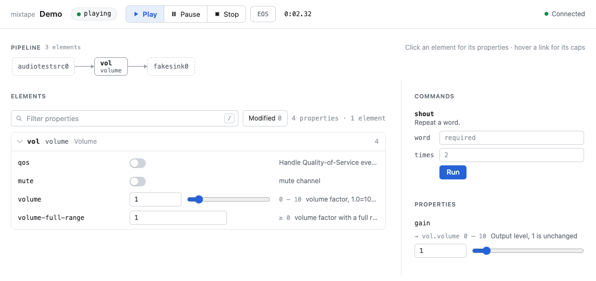

# mixtape: awesome mix vol. 1 🎵📼 

[![Pypi version]][PyPI] [![Python versions]][PyPI] [![Build Status]][CI] [![Pypi license]][License] [![Docs]][Documentation]

|[●▪▪●]| mixtape is a Python GStreamer application framework.

**This project is in pre-alpha and the API is most likely to change**

**Documentation: [shashi.to/mixtape](https://shashi.to/mixtape/)** · [Changelog](https://shashi.to/mixtape/changelog/)

[GStreamer] is a pipeline based framework for building complex multimedia processing 
systems. It is written in C, based on [GObject], and offers several bindings in other languages,
including python. If you are unfamiliar with GStreamer, you should start with the
[GStreamer tutorials].

## Project goal

Python is a great language for prototyping and integration tests. The goal of the project is 
to have something in between `gst-launch` and writing a full python application for testing
and prototyping.

*Features*:

* An asyncio `Player` to subclass, driven from the pipeline's bus.
* Pipeline metrics from GStreamer's own tracers, live, in a report, or for every test of a
  pytest suite, with budgets and baselines.
* A declarative model of a player's commands and properties, and of its elements'.
* Auto-generated `cmdline` (`mixtape run`, `mixtape inspect`) and `http` (a control page and
  a REST and WebSocket API) interfaces, started from a pipeline description.
* Pluggable features: `leaks`, `tracers` and `perf` are built in, and `gst:NAME` makes any
  GStreamer tracer one.

## Why mixtape

- **Over `gst-launch-1.0`.** `gst-launch-1.0` runs a description, and that is all: you cannot
  change a property or call a command while it plays, it has no model of what the pipeline
  exposes, no metrics and nothing to test with. `mixtape run` plays the same description and
  adds `--set`, a control page, a REST and WebSocket API and live metrics.
- **Over raw gst-python.** gst-python can do everything mixtape does. mixtape adds an asyncio
  `Player`: the bus as events, pipeline errors as exceptions, `await player.play()` that
  returns when the state is reached, and a typed model of properties and commands that the
  command line, the API and the control page all read.
- **Over RidgeRun's gstd.** gstd is a daemon that controls many pipelines over TCP or HTTP.
  mixtape has a typed model with JSON Schema, a control page generated from it and a Python
  application framework. It has no daemon for many pipelines, no authentication and no C
  client libraries.
- **Over tracer analysis.** GstShark and `gst-stats` analyse the logs of a run, after it.
  mixtape's `perf` reads GStreamer's tracers while the pipeline plays, draws them on the
  control page and writes a report.
- **Budgets and baselines in pytest.** The one to try first: `@pytest.mark.perf(...)` fails a
  test whose pipeline latency or CPU is over a limit, and `--mixtape-perf-baseline` fails a
  session that got slower than an earlier one.

It is not for Windows (it reads the bus through a file descriptor and handles Unix signals),
for serving many pipelines or authenticating clients on a network, or for a production daemon.

## Install

`mixtape` needs Python 3.12 or newer, GStreamer and PyGObject (`gi`). The last two come from
your system, not from PyPI, and so does the Python: a system Python of 3.12 or newer means
Ubuntu 24.04 or newer, or Debian 13 or newer on Linux.

```console
$ brew install gstreamer    # macOS
$ sudo apt install python3-gi python3-gst-1.0 python3-venv gstreamer1.0-tools \
    gstreamer1.0-plugins-base gstreamer1.0-plugins-good    # Debian/Ubuntu
```

Make a venv from a Python that has the bindings: `python3 -c 'import gi; gi.require_version("Gst", "1.0"); from gi.repository import Gst; Gst.IteratorError'` must succeed
(Homebrew's is `$(brew --prefix)/bin/python3`, Ubuntu's and Debian's is `/usr/bin/python3`).
`--system-site-packages` lets the venv see them, and the `http` extra adds the control page.

### From PyPI

```console
$ python3 -m venv --system-site-packages .venv && . .venv/bin/activate
$ pip install 'mixtape[http]'
```

### From a source checkout

The examples in the documentation are those of the `main` branch, and they can need code that
is newer than the PyPI release. They and the commands next to them run from the folder of a
checkout, so install from one to run them:

```console
$ git clone https://github.com/ashwoods/mixtape
$ cd mixtape
$ python3 -m venv --system-site-packages .venv && . .venv/bin/activate
$ pip install -e '.[http]'
```

## Quick start

Play a pipeline, and control it from a browser with live metrics:

```console
$ mixtape run "videotestsrc num-buffers=60 ! fakesink" && echo done
done
```

```console
$ mixtape run --http 8047 --feature perf "videotestsrc is-live=true ! queue name=q ! autovideosink"
Serving on http://127.0.0.1:8047
```

Open that address for a control page. It is generated from the player's model: this is the
page of `examples/demo.py`, a player with a volume element and a `shout` command:



The [documentation](https://shashi.to/mixtape/) covers the command line,
writing an application with `Player`, the HTTP API, measuring performance, a WebRTC client and
pipelines that talk to each other. Every command and snippet in it runs in the test suite,
except the installs and the commands that need a camera, a window or a server of yours, which
the page says.

## Development

[CONTRIBUTING.md](https://github.com/ashwoods/mixtape/blob/main/CONTRIBUTING.md) has what to install and how the checks work. In short, with
[uv] and GStreamer installed:

```console
$ scripts/check
```

----

    ....___.___.___.___.___.__....
    |:                          :|
    |:    Awesome mix vol 1     :|
    |:     ,-.   _____   ,-.    :|
    |:    ( `)) [_____] ( `))   :|
    |:     `-`   ' ' '   `-`    :|
    |:     ,______________.     :|
    |...../::::o::::::o::::\.....|
    |..../:::O::::::::::O:::\....|
    |---/----.----.----.-----`---|

We are Groot.

[GStreamer]: https://gstreamer.freedesktop.org/
[uv]: https://docs.astral.sh/uv/
[GObject]: https://docs.gtk.org/gobject/
[GStreamer tutorials]: https://gstreamer.freedesktop.org/documentation/tutorials/index.html
[Pypi version]: https://img.shields.io/pypi/v/mixtape.svg
[Pypi license]: https://img.shields.io/pypi/l/mixtape.svg
[Python versions]: https://img.shields.io/pypi/pyversions/mixtape.svg
[Build Status]: https://github.com/ashwoods/mixtape/actions/workflows/ci.yml/badge.svg?branch=main
[Docs]: https://img.shields.io/website?url=https%3A%2F%2Fshashi.to%2Fmixtape%2F&label=docs
[PyPI]: https://pypi.org/project/mixtape/
[CI]: https://github.com/ashwoods/mixtape/actions/workflows/ci.yml
[License]: https://github.com/ashwoods/mixtape/blob/main/LICENSE
[Documentation]: https://shashi.to/mixtape/
