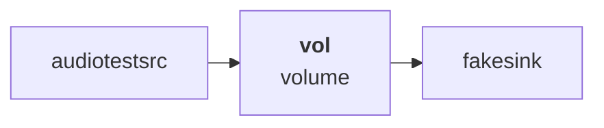

# Command line

`mixtape` plays a pipeline from a `gst-launch-1.0` description and, without any code, gives it
the same commands, properties and control page that a [`Player`](library.md) you write has:

- `mixtape run` plays a pipeline until it ends,
- `mixtape inspect` prints what a player exposes, without playing,
- `--set` sets properties before playing, `--http` adds the [control page](http.md), and
  `--feature` adds [features](#features) such as tracers.

`python3 -m mixtape` does the same as `mixtape`.

## Run a pipeline

`mixtape run` plays the description until EOS or an error, like `gst-launch-1.0 -e`. The
description is one quoted string, or the words of it:

```console
$ mixtape run videotestsrc num-buffers=60 ! fakesink; echo "exit status $?"
exit status 0
```

It exits 0 at EOS, 1 on a pipeline error, and 2 on a bad description or bad usage. A
description that GStreamer cannot parse never starts:

```console
$ mixtape run "videotestsrc ! nosuchelement ! fakesink"; echo "exit status $?"
error: Invalid pipeline 'videotestsrc ! nosuchelement ! fakesink': no element "nosuchelement"
exit status 2
```

An element that fails while playing says which one, and exits 1:

```console
$ mixtape run "filesrc location=/tmp/missing.mp4 ! fakesink"; echo "exit status $?"
error: filesrc0: Resource not found.
exit status 1
```

`-v` logs what the player does, at info level, and shows the debug string of an error, the
line of GStreamer's source and the details that belong to it. `-vv` logs at debug level. It
works before or after `run`:

```console
$ mixtape run -v "filesrc location=/tmp/missing.mp4 ! fakesink" 2>&1 | grep "No such file"
No such file "/tmp/missing.mp4"
```

On macOS, `mixtape run` also runs the main run loop, so the windows of `autovideosink` and
the other video sinks appear.

### Ctrl-C

The first Ctrl-C (or SIGTERM) sends an EOS and stops cleanly, so a recorder finishes its
file, and `mixtape run` exits 0:

```console
$ mixtape run "videotestsrc is-live=true ! fakesink" &
$ sleep 2
$ kill -INT $!
$ wait $!; echo "exit status $?"
Interrupt: stopping (EOS)…
exit status 0
```

A pipeline whose streaming thread hangs never carries the EOS to its sinks. It gets 5 s for
the EOS and 5 s to stop, and then `mixtape run` exits 1 and names the elements that are still
changing state. Here `identity` sleeps for 30 s on each buffer:

```console
$ mixtape run "videotestsrc ! identity sleep-time=30000000 ! fakesink" &
$ sleep 2
$ kill -INT $!
$ wait $!; echo "exit status $?"
Interrupt: stopping (EOS)…
error: Could not set the pipeline to null within 5 s: identity0 still changing
exit status 1
```

A second Ctrl-C does not wait for that: it stops at once and exits 130. A third one kills
the process, as it would without `mixtape`.

```console
$ mixtape run "videotestsrc ! identity sleep-time=30000000 ! fakesink" &
$ sleep 2
$ kill -INT $!
$ sleep 1
$ kill -INT $!
$ wait $!; echo "exit status $?"
Interrupt: stopping (EOS)…
Interrupt: stopping now (Ctrl-C again to kill)…
WARNING mixtape.player: Could not set the pipeline to null within 5 s: identity0 still changing: leaving it
exit status 130
```

## Inspect a player

A player describes what it exposes: its commands, its properties, with their types, ranges
and current values, and the properties of its elements. `mixtape inspect` prints that without
playing, for a description or for a `module:Class`, the player class of a program of yours.
This one has the alias of an element property, made with `prop()`, and a `@command`; its
`description` is the pipeline that `mixtape` builds for it (see
[Writing an application](library.md)):



```python
--8<-- "examples/demo.py:player"
```

`demo` is a module in the current folder, which `mixtape` finds there:

```console
$ cd examples && mixtape inspect demo:Demo
Demo

Commands:
  pause()                                                 Pause the pipeline.
  play()                                                  Play the pipeline.
  stop(eos: boolean = false, timeout: number | null = 5)  Set the pipeline to NULL, after an EOS when `eos` and it is playing.
  eos(timeout: number | null = 5)                         Send an EOS event and wait for the EOS message it causes, while playing, for up to
  seek(position: number)                                  Seek to a position in seconds, flushing.
  shout(word: string, times: integer = 2)                 Repeat a word.

Properties:
  state     r-  null|ready|paused|playing  = null                Pipeline state
  position  r-  number                     = null                Playback position in seconds
  duration  r-  number                     = null                Duration in seconds
  gain      rw  number 0..10               = 1     → vol.volume  Output level, 1 is unchanged

vol (volume) — Volume
  qos                rw  boolean       = false    Handle Quality-of-Service events
  mute               rw  boolean       = false    mute channel
  volume             rw  number 0..10  = 1        volume factor, 1.0=100%
  volume-full-range  rw  number        = 1        volume factor with a full range of values, 1.0=100%
```

Each command is a signature and its description. Each property has its path, whether it is
readable (`r`) and writable (`w`), its type with its range or its choices, its current value
after `=`, and a description. `gain` is an alias: `→ vol.volume` says which element property
it is, and `gain` and `vol.volume` are the same value. Below come the elements.

An element property can say `mutable: playing`, which is only what the element declares about
changing it in that state: `mixtape` does not enforce it, and setting a property while
playing is up to the element:

```console
$ mixtape inspect "videotestsrc ! x264enc name=enc ! fakesink" | grep bitrate
  bitrate                      rw  integer 1..2048000                = 2048      mutable: playing  Bitrate in kbit/sec
```

### As JSON

`--json` prints the same model as JSON: each property has its JSON Schema, and each command
the schema of its parameters and of its result. It is what `GET /api/model` of the
[HTTP API](http.md) returns. This is the `gain` property of the player above:

```console
$ cd examples && mixtape inspect --json demo:Demo \
    | python3 -c 'import json, sys; print(json.dumps(json.load(sys.stdin)["properties"]["gain"], indent=2))'
{
  "path": "gain",
  "builtin": false,
  "element": "vol",
  "property": "volume",
  "target": "vol.volume",
  "schema": {
    "maximum": 10.0,
    "minimum": 0.0,
    "type": "number",
    "default": 1.0,
    "description": "volume factor, 1.0=100%"
  },
  "readable": true,
  "writable": true,
  "controllable": true,
  "mutable": null,
  "description": "Output level, 1 is unchanged"
}
```

### Which elements

Only the elements you name (`name=src`) are exposed. The others are implementation, and
`videotestsrc0` is not a stable name to build on:

```console
$ mixtape inspect "videotestsrc name=src ! fakesink" | grep -E ' \(.*\) — '
src (videotestsrc) — Video test source
```

`--expose-all` exposes every element, and the pipeline itself:

```console
$ mixtape inspect --expose-all "videotestsrc ! fakesink" | grep -E ' \(.*\) — '
pipeline0 (pipeline) — Pipeline object
videotestsrc0 (videotestsrc) — Video test source
fakesink0 (fakesink) — Fake Sink
```

The elements inside a `playbin` or a `decodebin` are never named by you, so they only show up
with `--expose-all`.

When two elements have the same name, in different bins, each is keyed by its dotted path,
`a.q` and `b.q`, and a bare `q` names neither:

```console
$ mixtape inspect "bin.( name=a queue name=q ) bin.( name=b queue name=q )" | grep -E ' \(.*\) — '
a (bin) — Generic bin
a.q (queue) — Queue
b (bin) — Generic bin
b.q (queue) — Queue
```

### Action signals are commands

The action signals of an exposed element are commands, named `element.signal`. GObject keeps
no names for their arguments, so they are `arg1`, `arg2`... The model supports the signals
whose arguments and result are booleans, numbers, strings, enums, caps or structures; a tag list or a
structure comes back as JSON. An `appsrc` named `src` gets `src.end-of-stream`:

```console
$ mixtape inspect "appsrc name=src ! fakesink" | grep "src\."
  src.end-of-stream()                                     Emit the action signal 'end-of-stream' of GstAppSrc
```

## Set properties

`--set PATH=VALUE` sets a property before the pipeline plays, and can be repeated. `PATH` is
a property of the player, an alias such as `gain` or a built-in, or `element.property`; this
is the name that `inspect` prints first in each row:

```console
$ cd examples && mixtape run demo:Demo --set gain=0.5 --set vol.mute=true && echo done
done
```

The value is a string on the command line; `mixtape` validates it against the type and the
range of the property, and converts it. One that is out of range, of the wrong type or for a
property that does not exist is refused before anything plays, with `error: ` and exit status 2:

```console
$ mixtape run "audiotestsrc num-buffers=10 ! volume name=vol ! fakesink" --set vol.volume=11; echo "exit status $?"
error: Invalid value for 'vol.volume': Input should be less than or equal to 10
exit status 2
```

A name that is ambiguous is refused too:

```console
$ mixtape run --set q.max-size-buffers=5 \
    "bin.( name=a queue name=q ) bin.( name=b queue name=q )"; echo "exit status $?"
error: 'q' is ambiguous: use a.q or b.q
exit status 2
```

## A control page: `--http`

`--http [HOST:]PORT` serves the player over HTTP in the same process and plays it, until you
press Ctrl-C. It needs the `http` extra (`pip install 'mixtape[http]'`):

```console
$ cd examples && mixtape run --http 8047 demo:Demo
Serving on http://127.0.0.1:8047
```

Open that address for the control page, which is generated from the model: the transport
(play, pause, stop, EOS) and the position, the pipeline's graph, a form for each command, and a
control for each property, which follows the pipeline live. The [HTTP API](http.md) page has a
screenshot, the REST and WebSocket API behind the page, and what to know before binding it to
another address.

An EOS or a pipeline error does not end `mixtape run --http`: errors are printed, and the page
can play again. The first Ctrl-C sends an EOS, stops, and exits 0.

## Features

A feature is a plugin of a player. It adds commands and live properties to the model, next to
the elements', as `feature.name`. `--feature NAME[,KEY=VALUE…]` enables one, and can be
repeated; its options are the `KEY=VALUE` pairs after the name, and a value may contain commas
only inside parentheses. `mixtape run --help` lists the features that are installed. A name that
is not one fails before anything plays:

```console
$ mixtape inspect --feature nope "videotestsrc ! fakesink"; echo "exit status $?"
error: Unknown feature 'nope'; available: leaks, perf, tracers
exit status 2
```

The same features can be enabled in code, with the `features` argument of a `Player` or
a `features` attribute of its class (see [Writing an application](library.md)). The built-in
ones are `leaks`, `tracers` and `perf`, and `gst:NAME` makes any GStreamer tracer a feature.

### leaks

`leaks` counts the GStreamer objects that were created and not yet freed since it attached,
by type. A count that keeps growing in a steady pipeline is a leak. Its `interval` option is
how often, in seconds, the count is published:

```console
$ mixtape inspect --feature leaks,interval=0.5 "videotestsrc ! fakesink"
Player
Features: leaks

Commands:
  pause()                                                 Pause the pipeline.
  play()                                                  Play the pipeline.
  stop(eos: boolean = false, timeout: number | null = 5)  Set the pipeline to NULL, after an EOS when `eos` and it is playing.
  eos(timeout: number | null = 5)                         Send an EOS event and wait for the EOS message it causes, while playing, for up to
  seek(position: number)                                  Seek to a position in seconds, flushing.
  leaks.checkpoint()                                      The change in live objects by type since the last checkpoint
  leaks.reset()                                           Forget the live objects counted so far, and go on tracking

Properties:
  state        r-  null|ready|paused|playing  = null    Pipeline state
  position     r-  number                     = null    Playback position in seconds
  duration     r-  number                     = null    Duration in seconds
  leaks.alive  r-  object                     = {}      Objects created since tracking started and not yet freed, by type
```

`leaks.checkpoint` returns what changed since its last call, and `leaks.reset` starts counting
again. The count comes from GStreamer's `leaks` tracer. A tracer exists only if
`GST_TRACERS` names it before GStreamer is initialised, and there is one per process. `mixtape run`
prepares its features before anything else initialises GStreamer, so the command line needs
nothing more. In code, build the player with `Player.from_description`, first in the process.

### tracers

`tracers` runs GStreamer's tracers along with the player. Its `names` option takes the syntax
of `GST_TRACERS`: tracers separated by `;`, with their parameters in parentheses (commas
included). They can be core tracers (`latency`, `rusage`, `stats`...) or those of
gst-plugins-rs (`queue-levels`, `buffer-lateness`...). The `tracers.active` property lists the
ones that run:

```console
$ mixtape inspect --feature 'tracers,names=latency(flags=element+pipeline);rusage' \
    "videotestsrc ! fakesink" | grep tracers.active
  tracers.active  r-  list string                     = latency+rusage    The tracers GStreamer runs in this process
```

The core tracers only write to GStreamer's debug log, so `log`, which is on by default, adds
`GST_TRACER:7` to `GST_DEBUG`. Here are the lines that two of them wrote:

```console
$ mixtape run "videotestsrc num-buffers=30 ! queue ! fakesink" \
    --feature 'tracers,names=latency(flags=element+pipeline);rusage' 2>&1 \
    | grep -o -E '(element-latency|proc-rusage),' | sort -u
element-latency,
proc-rusage,
```

What your environment already sets in `GST_TRACERS` or `GST_DEBUG` is kept, with a warning. A
tracer that is not installed fails the player, and so does one that GStreamer was initialised
without: like `leaks`, `tracers` has to be first in the process, which rules out a pytest run
whose earlier tests initialised GStreamer.

### perf

`perf` measures the pipeline with GStreamer's own tracers, and publishes a summary of each
metric by element, pad and thread, with a report and a live view on the control page. It is
the subject of [Measuring performance](perf.md); the command line is
`mixtape run "..." --feature perf,out=DIR`.

### gst:NAME

`gst:NAME` makes any GStreamer tracer a feature: a core tracer, or one of a plugin on
`GST_PLUGIN_PATH`, in any language, with no Python of its own. The `KEY=VALUE` options are the
tracer's parameters: `gst:latency,flags=element` is `latency(flags=element)` in `GST_TRACERS`.
The tracer's readable properties become read-only properties, `gst:NAME.property`, published
when the tracer notifies them (the `latency` tracer has its `flags` as a property since
GStreamer 1.26):

```console
$ mixtape inspect --feature gst:latency,flags=element "videotestsrc ! fakesink" | grep "gst:"
Features: gst:latency
  gst:latency.params  r-  string                           = null       Extra configuration parameters
  gst:latency.flags   r-  flags pipeline|element|reported  = element    Flags to control what latency measurements to perform
```

Its action signals become commands, `gst:NAME.signal`, as the elements' do. Of the
gst-plugins-rs tracers, `queue-levels`, `buffer-lateness` and `pad-push-timings` have a
`write-log` command that writes their CSV to the file `arg1`:

```console
$ mixtape inspect --feature gst:queue-levels "videotestsrc ! fakesink" | grep "write-log"
  gst:queue-levels.write-log(arg1: string | null)         Emit the action signal 'write-log' of GstQueueLevels
```

`pipeline-snapshot` has `snapshot`, which writes the pipelines' dot files. A structure that a
tracer's signal returns, such as the counters of a custom tracer, comes back as JSON. Commands
are called with the control page or the [HTTP API](http.md), so here with `curl`:

```console
$ mixtape run --http 8047 --feature gst:queue-levels \
    "videotestsrc is-live=true ! queue name=q ! fakesink" 2>/dev/null &
$ until curl -sf 127.0.0.1:8047/api/model > /dev/null; do sleep 0.2; done
$ curl -s -X POST 127.0.0.1:8047/api/commands/gst:queue-levels.write-log \
    -d '{"arg1": "/tmp/q.csv"}'; echo
$ cut -d, -f2 /tmp/q.csv | sort -u
$ kill -INT $!
{"result":null}
q
```

Two tracers cannot be read by two features. A tracer that `perf` reads is refused beside it,
and `gst:leaks` is refused for good: use the `leaks` feature, as the signals of its tracer
crash the process when they are called out of order:

```console
$ mixtape run --feature gst:leaks "videotestsrc num-buffers=30 ! fakesink"; echo "exit status $?"
error: The feature 'gst:leaks' is not supported: use the feature 'leaks': the tracer's signals crash the process or corrupt reference counts when called out of order (activity-get-checkpoint before activity-start-tracking, get-live-objects from Python)
exit status 2
```

As for `tracers`, a `gst:` feature has to be first in the process.
