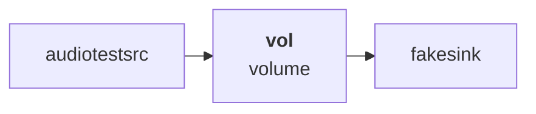
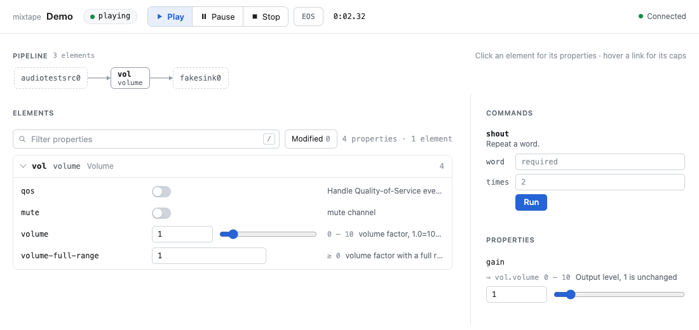
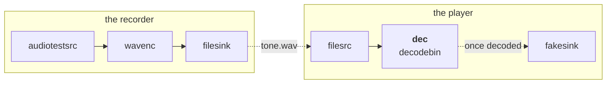

# HTTP API

The optional `http` extra (FastAPI and uvicorn) controls a player from a browser, from `curl`,
or from any program that speaks HTTP and WebSocket. It adds a control page, a REST API for the
commands and properties, and a WebSocket that streams the player's events. It is generated from
the player's model, so it exposes what [`mixtape inspect`](cli.md#inspect-a-player) prints,
for any pipeline or [player class](library.md). No threads are involved: the server runs in the
player's own asyncio loop.

```console
$ pip install 'mixtape[http]'
```

## Serve a player

`--http [HOST:]PORT` serves the player and plays it, until you press Ctrl-C. `HOST` defaults to
`127.0.0.1`; an IPv6 address goes in brackets. Here is a player with an alias and a command,
which `mixtape inspect` shows on the [command line](cli.md#inspect-a-player) page:



```console
$ mixtape run --http 8047 examples/demo.py:Demo
Serving on http://127.0.0.1:8047
```

What ends it, and what happens on an EOS, an error or Ctrl-C, is on the
[command line](cli.md#the-http-option) page.

The commands below, which call the API with `curl`, start the server in the background, silence
its messages, wait until it answers, and stop it on their last line. That way each of them runs
alone; in a terminal of yours you would start it once, as above. They use the address
`127.0.0.1`, as a name may resolve to an IPv6 address that something else listens on.

## The control page { #the-control-page }

`GET /` is a page that is generated from the model:



- At the top, the player's name and state, the transport (play, pause, stop and an EOS), the
  position and whether the page is connected. The transport buttons, the seek bar and the *Run*
  button of a command are disabled while the command cannot run, with the reason.
- The pipeline graph: the elements and the links between them, drawn dashed when the element is
  not exposed. Click an element to jump to its properties and hover a link for its caps.
- A section for each exposed element, with a control for each of its properties: a switch, a
  number with a slider where the property has a range, a choice for an enum. They follow the
  pipeline live.
- On the right, a form for each command, and the properties of the player: the aliases of your
  class (`gain`) and those of its features.
- `/` filters the properties, and "Modified" shows those that differ from their default.

The graph and the element sections follow the pipeline as it changes, a `decodebin`'s elements,
new pads, links and caps, without a reload. With the `perf` feature (see
[Measuring performance](perf.md)) the page also draws the metrics, live.

## REST

| Route | What it does |
|---|---|
| `GET /api/model` | the player's `describe()`: its commands, properties and elements, as JSON (see `mixtape inspect --json`), with `unavailable`: the commands that cannot run now, with the reason |
| `GET /api/graph` | its `graph()`: the elements and the links between them, with their caps |
| `POST /api/commands/<name>` | runs a command with the JSON object in the body as its arguments, which is optional, and returns `{"result": ...}` |
| `GET /api/elements/<element>` | the readable properties of an exposed element, as `{name: value}` |
| `PATCH /api/elements/<element>` | sets properties of an element from a JSON `{name: value}`, and returns the new values |
| `GET /api/properties` | the readable properties of the player: the built-ins, its aliases and those of its features |
| `PATCH /api/properties` | sets some of them |
| `GET /docs` | the OpenAPI documentation, generated from the model |

Here is a player that plays a live source, started with `--set vol.volume=0.25`, which is
already in the values:

```console
$ mixtape run --http 8047 --set vol.volume=0.25 \
    "audiotestsrc is-live=true ! volume name=vol ! fakesink name=sink" 2>/dev/null &
$ until curl -sf 127.0.0.1:8047/api/model > /dev/null; do sleep 0.2; done
$ curl -s 127.0.0.1:8047/api/model | head -c 90; echo
$ curl -s 127.0.0.1:8047/api/graph; echo
$ curl -s 127.0.0.1:8047/api/elements/vol; echo
$ curl -s 127.0.0.1:8047/api/properties; echo; kill -INT $!
{"name":"Player","features":[],"commands":{"pause":{"name":"pause","description":"Pause the pipeline.","param
{"pipeline":"pipeline0","nodes":{"audiotestsrc0":{"name":"audiotestsrc0","factory":"audiotestsrc","parent":null,"bin":false,"exposed":false},"vol":{"name":"vol","factory":"volume","parent":null,"bin":false,"exposed":true},"sink":{"name":"sink","factory":"fakesink","parent":null,"bin":false,"exposed":true}},"links":[{"source":"audiotestsrc0","source_pad":"src","sink":"vol","sink_pad":"sink","caps":"audio/x-raw, format=(string)S16LE, layout=(string)interleaved, rate=(int)44100, channels=(int)1"},{"source":"vol","source_pad":"src","sink":"sink","sink_pad":"sink","caps":"audio/x-raw, format=(string)S16LE, layout=(string)interleaved, rate=(int)44100, channels=(int)1"}]}
{"qos":false,"mute":false,"volume":0.25,"volume-full-range":0.25}
{"state":"playing","position":0.52,"duration":null}
```

Elements are keyed as `mixtape inspect` shows them: by their name, or by their dotted path
(`a.q`) when two share a name. A name that is not given, `audiotestsrc0`, is not exposed, so
there is no `/api/elements/audiotestsrc0`, but the graph shows it.

### Set properties and run commands

`PATCH` takes a JSON object of values, applies them in order, and stops at the first one that is
wrong; those before it stay set. It returns the new values of what it set. `POST
/api/commands/<name>` takes the arguments of the command as a JSON object, and every command
is a route: the transport (`play`, `pause`, `stop`, `eos`, `seek`), those of your player class,
and those that elements and features add:

```console
$ mixtape run --http 8047 \
    "audiotestsrc is-live=true ! volume name=vol ! fakesink name=sink" 2>/dev/null &
$ until curl -sf 127.0.0.1:8047/api/model > /dev/null; do sleep 0.2; done
$ curl -s -X PATCH 127.0.0.1:8047/api/elements/vol -d '{"volume": 0.5, "mute": true}'; echo
$ curl -s -X POST 127.0.0.1:8047/api/commands/pause; echo
$ curl -s 127.0.0.1:8047/api/properties | grep -o '"state":"[a-z]*"'; kill -INT $!
{"volume":0.5,"mute":true}
{"result":null}
"state":"paused"
```

The aliases of a player class and its own commands work the same, in `/api/properties` and
under `/api/commands`. The `gain` alias of the `Demo` player is the `volume` of its `vol`, and
`shout` returns a result:

```console
$ mixtape run examples/demo.py:Demo --http 8047 2>/dev/null &
$ until curl -sf 127.0.0.1:8047/api/model > /dev/null; do sleep 0.2; done
$ curl -s -X PATCH 127.0.0.1:8047/api/properties -d '{"gain": 0.25}'; echo
$ curl -s 127.0.0.1:8047/api/elements/vol; echo
$ curl -s -X POST 127.0.0.1:8047/api/commands/shout -d '{"word": "hi", "times": 3}'; echo; kill -INT $!
{"gain":0.25}
{"qos":false,"mute":false,"volume":0.25,"volume-full-range":0.25}
{"result":"hihihi"}
```

### Errors

An error is `{"detail": "...", "errors": [...]}`, where `errors` is there for a value that was
refused, with what is wrong with it. The status says whose fault it is:

| Status | When |
|---|---|
| 404 | an unknown element, property or command name |
| 422 | a value that does not fit the property or the arguments of a command, a body that is not a JSON object, or a read-only property |
| 409 | a command that cannot do what was asked now, such as an EOS while the pipeline is not playing, or that [cannot run](library.md#commands-that-cannot-run) |
| 500 | the pipeline failed: `detail` has the element and its message |
| 403 | the `Host` or `Origin` of the request is refused (see [Security](#security)) |

```console
$ mixtape run --http 8047 \
    "audiotestsrc is-live=true ! volume name=vol ! fakesink name=sink" 2>/dev/null &
$ until curl -sf 127.0.0.1:8047/api/model > /dev/null; do sleep 0.2; done
$ curl -s -X PATCH 127.0.0.1:8047/api/elements/vol -d '{"volume": 11}' -w ' %{http_code}\n'
$ curl -s -X PATCH 127.0.0.1:8047/api/elements/nosuch -d '{"volume": 1}' -w ' %{http_code}\n'
$ curl -s -X PATCH 127.0.0.1:8047/api/properties -d '{"state": "null"}' -w ' %{http_code}\n'
$ curl -s -X POST 127.0.0.1:8047/api/commands/seek -d '{"position": -1}' -w ' %{http_code}\n'
$ curl -s -X POST 127.0.0.1:8047/api/commands/pause > /dev/null
$ curl -s -X POST 127.0.0.1:8047/api/commands/eos -w ' %{http_code}\n'; kill -INT $!
{"detail":"Invalid value for 'vol.volume': Input should be less than or equal to 10","errors":[{"type":"less_than_equal","loc":[],"msg":"Input should be less than or equal to 10","input":11}]} 422
{"detail":"Unknown element 'nosuch'"} 404
{"detail":"'state' is read-only"} 422
{"detail":"Invalid arguments for 'seek': position: Input should be greater than or equal to 0","errors":[{"type":"greater_than_equal","loc":["position"],"msg":"Input should be greater than or equal to 0","input":-1}]} 422
{"detail":"EOS needs a playing pipeline that is not at its EOS"} 409
```

A command that says when it can run is refused with a 409 and its reason while it cannot, and
`unavailable` in the model lists those commands. This `Recorder`, from
[Writing an application](library.md#commands-that-cannot-run), can finish only after it started:

```console
$ mixtape run --http 8047 examples/lib_available.py:Recorder 2>/dev/null &
$ until curl -sf 127.0.0.1:8047/api/model > /dev/null; do sleep 0.2; done
$ curl -s 127.0.0.1:8047/api/model \
    | python3 -c 'import json, sys; print(json.load(sys.stdin)["unavailable"]["finish"])'
$ curl -s -X POST 127.0.0.1:8047/api/commands/finish -w ' %{http_code}\n'
$ curl -s -X POST 127.0.0.1:8047/api/commands/start > /dev/null
$ curl -s -X POST 127.0.0.1:8047/api/commands/finish -w ' %{http_code}\n'; kill -INT $!
Not recording
{"detail":"Not recording"} 409
{"result":null} 200
```

A pipeline that cannot play does not stop the server. Its error is printed when it happens, and
the API answers with 500 when a command needs the pipeline, while the model and the values stay
readable:

```console
$ mixtape run --http 8047 "filesrc location=/tmp/missing.mp4 ! fakesink" 2>/dev/null &
$ until curl -sf 127.0.0.1:8047/api/model > /dev/null; do sleep 0.2; done
$ curl -s -X POST 127.0.0.1:8047/api/commands/play -w ' %{http_code}\n'
$ curl -s 127.0.0.1:8047/api/properties -w ' %{http_code}\n'; kill -INT $!
{"detail":"filesrc0: Resource not found."} 500
{"state":"null","position":null,"duration":null} 200
```

## Events: the WebSocket

`WS /api/events` sends what happens to the player as JSON, one object in each message, and takes
commands and values to set. It sends first what a page needs to draw itself:

1. `{"type": "model", "model": {...}}`, as `GET /api/model`,
2. `{"type": "values", "values": {path: value}}`, every readable property,
3. `{"type": "graph", "graph": {...}}`, as `GET /api/graph`,
4. and, when the pipeline has already failed, the `error` that stopped it.

Then come the events, as they happen:

| `type` | When | Fields |
|---|---|---|
| `state` | the pipeline changes state | `old`, `new`, `pending` |
| `property` | a property changes, from anywhere | `path`, `element`, `property`, `value` (`null` for one that is computed) |
| `position` | once on connecting, then when the position or the duration changes, read four times a second | `position`, `duration` in seconds |
| `eos` | the stream ended | |
| `error`, `warning` | a message on the bus | `source`, `message`, `debug` |
| `graph` | the pipeline's shape changes | the new `graph` |
| `model` | the exposed elements change | the new `model`, and the `values` of the elements it adds |
| `commands` | the commands that [cannot run](library.md#commands-that-cannot-run) change | `unavailable`, `{name: reason}` for each command that cannot run now |

The client sends `{"id": 1, "command": "play", "args": {}}` to run a command, and
`{"id": 2, "set": {"vol.volume": 0.5}}` to set properties, which are applied in order. It
answers each with `{"type": "reply", "id": 1, "result": ...}`, or with `"error": {"status":
404, "detail": "..."}` instead of `result`, where the status is the one the REST API would
return. A command that takes time, like `play`, does not stop the events from streaming, and
its reply comes when it is done.

This program connects, and sends a `set`, a command that does not exist and a `play`. The
replies are keyed by `id`, as the order that they and the events arrive in is not fixed:

```python
--8<-- "examples/http_events.py:client"
```

### A pipeline that changes shape

Some pipelines are not the same when they play as when they were built: a `decodebin` adds the
elements it needs once it knows what it is decoding, and pads appear and links are made. Each
time the shape changes, the socket sends a `graph` message, and a `model` message when the
exposed elements are not the same, with the `values` of the ones that were added, so a client
needs no other request. The `decodebin` elements are never named by you, so this one is played
with `expose_all`, which exposes them:



```python
--8<-- "examples/http_shape.py:watch"
```

## Security { #security }

There is no authentication. The server binds to `127.0.0.1` by default, and binding it to
another address says so, as anyone who can reach the port can control the player:

```console
$ mixtape run --http 0.0.0.0:8047 "videotestsrc is-live=true ! fakesink" 2>&1 &
$ until curl -sf 127.0.0.1:8047/api/model > /dev/null; do sleep 0.2; done
$ kill -INT $!
$ wait $!
warning: serving on 0.0.0.0 without authentication: anyone who can reach it can control the player
Serving on http://0.0.0.0:8047
Interrupt: stopping (EOS)…
```

What the server does check keeps another site that you have open in your browser from reaching
a player on your machine, by a cross-origin request or by DNS rebinding:

- A request whose `Origin` is not the `Host` it was sent to is refused with 403. Browsers send an
  `Origin` and `curl` does not, so `curl` and your programs pass.
- A request whose `Host` is a DNS name is refused with 403, except the loopback name and this
  machine's own name, so that a name that was rebound to your address does not pass. Bound to a
  loopback address, the `Host` must be a loopback one as well.
- The WebSocket is checked the same way, and a connection that is refused is closed with code 1008.

```console
$ mixtape run --http 8047 "videotestsrc is-live=true ! fakesink" 2>/dev/null &
$ until curl -sf 127.0.0.1:8047/api/model > /dev/null; do sleep 0.2; done
$ curl -s -H "Origin: http://evil.example" 127.0.0.1:8047/api/properties -w ' %{http_code}\n'
$ curl -s -H "Host: evil.example" 127.0.0.1:8047/api/properties -w ' %{http_code}\n'
$ curl -s -H "Origin: http://127.0.0.1:8047" 127.0.0.1:8047/api/properties -w ' %{http_code}\n'; kill -INT $!
{"detail":"Origin 'http://evil.example' does not match Host '127.0.0.1:8047'"} 403
{"detail":"Host 'evil.example' is not allowed"} 403
{"state":"playing","position":0.51,"duration":null} 200
```

## In code

`mixtape run --http` is [`serve()`](reference.md#mixtape.interfaces.http.serve) with the signal
handling of a command line. In a program of yours, `serve(player, host, port)` is an async
context manager that serves the player in the running loop until its block ends. It returns
once the server listens, with where it listens: the port `0` asks the system for a free one, and `listening.url` says which. It raises
`OSError` when the address is taken.

The server runs in the player's loop, so a client in the same program, as here, must not block
it:

```python
--8<-- "examples/http_serve.py:serve"
```

A program that serves until it is stopped waits for what stops it inside the block, such as
a signal, as `mixtape run --http` does, and [`create_app(player, host=...)`](reference.md#mixtape.interfaces.http.create_app) returns the FastAPI app, if you
have a server of your own to put it in.
