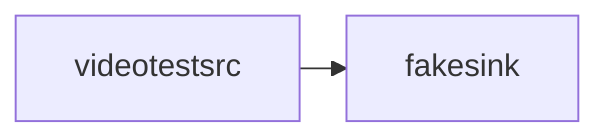

# mixtape

mixtape is a Python GStreamer application framework. It sits between `gst-launch-1.0` and a
full application: run a pipeline from the command line and get a control page, a REST and
WebSocket API and live metrics for it, or subclass its asyncio `Player` to build an
application of your own and get the same for free.

!!! warning "Pre-alpha"
    The API is likely to change between releases.

These pages describe mixtape 0.8.

## Install

mixtape needs Python 3.12 or newer, GStreamer and PyGObject (`gi`). The last two come from your
system, not from PyPI:

=== "macOS"

    ```console
    $ brew install gstreamer
    ```

=== "Ubuntu"

    ```console
    $ sudo apt install python3-gi python3-gst-1.0 python3-venv gstreamer1.0-tools \
        gstreamer1.0-plugins-base gstreamer1.0-plugins-good
    ```

Make a venv from a Python that has the GStreamer bindings. This command must succeed, and print
nothing, with the Python you start from (Homebrew's is `/opt/homebrew/bin/python3`, Ubuntu's
is `/usr/bin/python3`):

```console
$ python3 -c 'import gi'
```

If it prints `ModuleNotFoundError: No module named 'gi'`, see
[Troubleshooting](troubleshooting.md#no-module-named-gi). Then `--system-site-packages` lets the
venv see the bindings, and the `http` extra adds the control page:

```console
$ python3 -m venv --system-site-packages .venv && . .venv/bin/activate
$ pip install 'mixtape[http]>=0.8'
```

To run the examples on these pages, clone the repository. The commands on these pages run from
that folder:

```console
$ git clone https://github.com/ashwoods/mixtape
$ cd mixtape
```

## A first pipeline

`mixtape run` plays a `gst-launch-1.0` description until it ends, and exits 0:

```console
$ mixtape run "videotestsrc num-buffers=60 ! fakesink" && echo done
done
```

A description that GStreamer cannot parse never starts, and exits 2:

```console
$ mixtape run "videotestsrc ! nosuchelement"; echo "exit status $?"
error: invalid pipeline 'videotestsrc ! nosuchelement': no element "nosuchelement"
exit status 2
```

With `--http`, the same player is served until you press Ctrl-C. This one opens a video window,
so the page does not run it:

```console
$ mixtape run --http 8047 "videotestsrc is-live=true ! autovideosink"
Serving on http://127.0.0.1:8047
```

Open that address for a control page, generated from the pipeline, its properties and its
commands ([HTTP API](http.md#the-control-page)):


The same pipeline in Python: a `Player` drives it from an asyncio loop, and every message on
its bus is also an event:



```python
--8<-- "examples/hello.py:main"
```

The `# >` comments are what the program prints, and the tests check that it still does. Every
program on these pages is in [`examples/`](https://github.com/ashwoods/mixtape/tree/main/examples)
and runs from a checkout, here with `python3 examples/hello.py`.

## Where to go next

- [Command line](cli.md): `mixtape run` and `mixtape inspect`, setting properties, the control
  page with `--http`, and features with `--feature`.
- [Writing an application](library.md): subclass `Player`, declare properties and commands,
  react to events, and write a feature of your own.
- [HTTP API](http.md): the REST and WebSocket API behind the control page.
- [Measuring performance](perf.md): a real-world recorder measured with GStreamer's own tracers,
  its report, and budgets and baselines in a pytest suite.
- [A WebRTC client](webrtc.md): an application that calls another over WebRTC.
- [Two pipelines](two-pipelines.md): pipelines that feed each other, in one process or two.
- [Changelog](changelog.md): what changed in each release.

Every command and every snippet on these pages runs in mixtape's test suite, except the installs
and the commands that need a camera, a window or a server of yours, which the page says. Each
snippet links to its source and the tests that cover it. Something broke? See
[Troubleshooting](troubleshooting.md).
