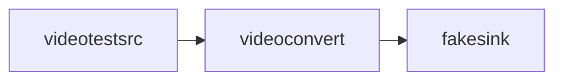
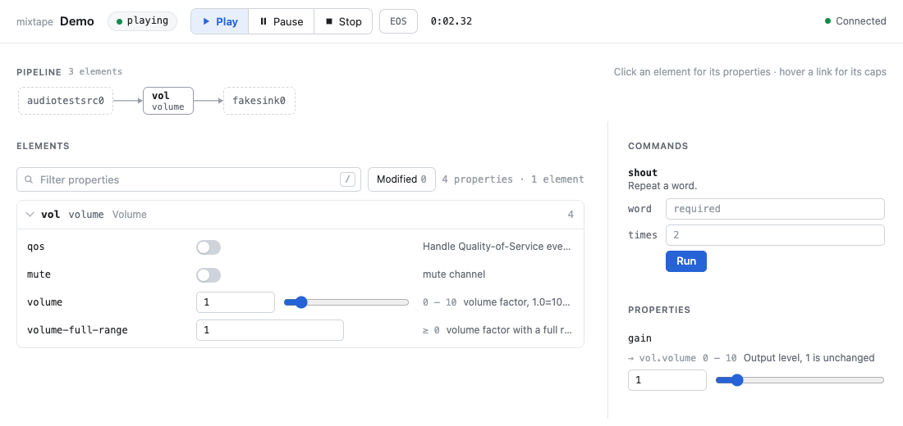

# mixtape

mixtape is a Python GStreamer application framework. It sits between `gst-launch-1.0` and a
full application: run a pipeline from the command line and get a control page, a REST and
WebSocket API and live metrics for it, or subclass its asyncio `Player` to build an
application of your own and get the same for free.

!!! warning "Pre-alpha"
    The API is likely to change between releases.

## Install

mixtape needs GStreamer and PyGObject (`gi`), which come from your system, not from PyPI:

=== "macOS"

    ```sh
    brew install gstreamer
    ```

=== "Ubuntu"

    ```sh
    sudo apt install python3-gi python3-gst-1.0 gstreamer1.0-tools \
        gstreamer1.0-plugins-base gstreamer1.0-plugins-good
    ```

Install mixtape into that Python, or into a venv created with `--system-site-packages` from
it. The `http` extra adds the control page:

```sh
python3 -m venv --system-site-packages .venv && . .venv/bin/activate
pip install 'mixtape[http]'
```

## A first pipeline

`mixtape run` plays a `gst-launch-1.0` description until it ends, and exits 0:

```sh
mixtape run "videotestsrc num-buffers=60 ! fakesink" && echo done
```

```
done
```

The same in Python: a `Player` drives the pipeline from an asyncio loop, and every message on
its bus is also an event:



```python
--8<-- "examples/hello.py:main"
```

```sh
python3 examples/hello.py
```

```
null -> ready
ready -> paused
paused -> playing
end of stream
```

With `--http`, a player is served with a control page, generated from its pipeline, its
properties and its commands ([HTTP API](http.md#the-control-page)):



## Where to go next

- [Command line](cli.md): `mixtape run` and `mixtape inspect`, setting properties, the control
  page with `--http`, and features with `--feature`.
- [Writing an application](library.md): subclass `Player`, declare properties and commands,
  react to events, and write a feature of your own.
- [HTTP API](http.md): the REST and WebSocket API behind the control page.
- [Measuring performance](perf.md): a real-world recorder measured with GStreamer's own tracers,
  its report, and budgets and baselines in a pytest suite.
- [A WebRTC client](webrtc.md): an application that calls another over WebRTC.
- [Two pipelines](two-pipelines.md): pipelines that feed each other, in one process or two.

Every command and every snippet on these pages runs in mixtape's test suite, and each snippet
links to its source and the tests that cover it.
