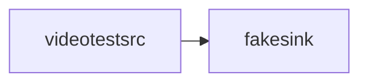
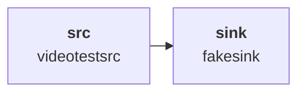
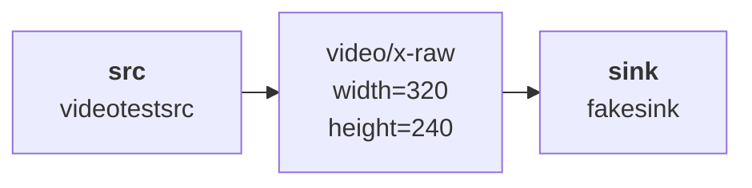
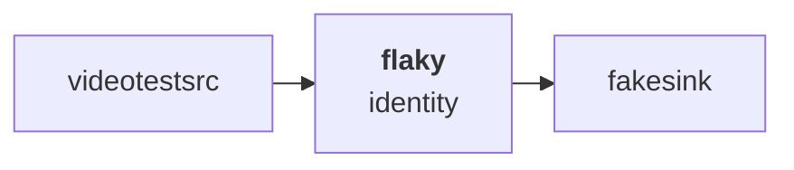
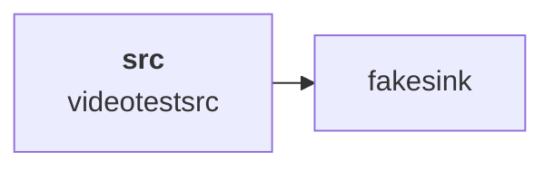
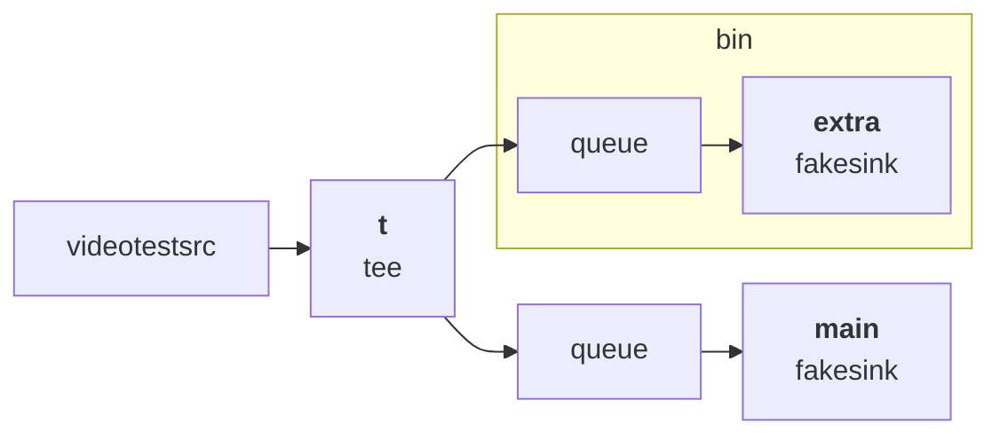
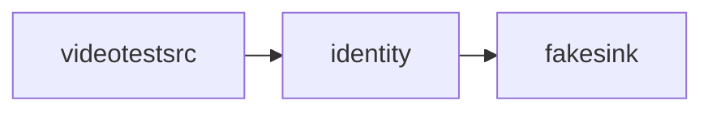

# Writing an application

mixtape is a library first: `mixtape run` is a small program built on it. This page builds
applications on the same pieces: a [`Player`](reference.md#mixtape.Player) that drives a
pipeline from an asyncio loop, the events it publishes, a model of its properties and commands
that the [command line](cli.md) and the [HTTP API](http.md) read, and features that add to that
model.

It starts with the smallest programs, then builds one application of its own, a test card: a
`Player` subclass with a pattern to choose, a frame counter and a command. Errors, events and
features follow as topics.

The names are in `mixtape` ([`Feature`](reference.md#mixtape.Feature),
[`prop`](reference.md#mixtape.prop), [`command`](reference.md#mixtape.command)),
[`mixtape.events`](reference.md#mixtape.events) and
[`mixtape.exceptions`](reference.md#mixtape.exceptions); the [API reference](reference.md) lists
them all.

## Play a pipeline

[`Player.from_description`](reference.md#mixtape.Player.from_description) builds a player from a
`gst-launch-1.0` description. It needs no
running loop: the first `await` on the player attaches it to the loop that is running, and
`async with` tears it down, setting the pipeline to NULL, when the block ends.



```python
--8<-- "examples/lib_lifecycle.py:lifecycle"
```

The `# >` comments under the prints are what the program prints; the tests check them.

[`play()`](reference.md#mixtape.Player.play), [`pause()`](reference.md#mixtape.Player.pause),
`ready()` and [`stop()`](reference.md#mixtape.Player.stop) return when the pipeline has reached
the state, not before. `stop()` sets it to NULL, after an EOS with `stop(eos=True)`. A player that
is torn down can be used again. Without `async with`, call
[`player.setup()`](reference.md#mixtape.Player.setup) on the loop to attach it and
[`player.teardown()`](reference.md#mixtape.Player.teardown) to detach it. A teardown fails the
waits it ends, a pending `play()` or `play_until_eos()`, with a `PlayerSetStateError`.

### Until the end of the stream

[`await player.play_until_eos()`](reference.md#mixtape.Player.play_until_eos) plays and returns
on the next EOS. The pipeline is still playing
then; calling it again plays the stream again, from READY:

```python
--8<-- "examples/lib_until_eos.py:until_eos"
```

[`Player.run`](reference.md#mixtape.Player.run) is the shortcut for a script: it plays a
description (or a `Gst.Pipeline`) until EOS, tears the player down and returns. It starts the
loop itself, so it cannot be called from a coroutine. It raises `TimeoutError` when `timeout`
seconds pass first, and [`PlayerPipelineError`](reference.md#mixtape.exceptions.PlayerPipelineError)
when the pipeline fails (see [When it goes wrong](#when-it-goes-wrong)).

```python
--8<-- "examples/lib_run.py:run"
```

### From a pipeline you built

A pipeline made in code, with `Gst.ElementFactory` and `link`, goes to `Player(pipeline)`.
GStreamer has to be initialised before the elements are made, so call `Gst.init(None)` first.
`from_description` does it for you, and wraps a description that is a single element in a
pipeline.



```python
--8<-- "examples/lib_dynamic.py:build"
```

Only elements with a name of your own are in the model:
[`describe().elements`](reference.md#mixtape.Player.describe) lists the
pipeline, `src` and `sink` here, and not `videotestsrc0`. Give a name to what you want to
read and set, or pass `expose_all=True` to expose every element.

## Subclass Player

Subclass [`Player`](reference.md#mixtape.Player) for an application of your own: its pipeline, its properties, its commands. The
test card has a `videotestsrc` and a `fakesink`, a `pattern` to choose, a count of the frames
that reached the sink and a command to show a pattern.



```python
--8<-- "examples/testcard.py:player"
```

What each part does:

- `description` is the pipeline of the class. `Testcard.from_description()`
  builds it, and so do `mixtape run examples/testcard.py:Testcard` and
  `mixtape inspect examples/testcard.py:Testcard`. A subclass with its own `__init__` takes the
  pipeline and passes the keyword arguments on (`expose_all`, `features`) to `super().__init__`.
- [`prop("src.pattern")`](reference.md#mixtape.prop) declares an alias of an element property: `pattern` in the model, with the
  type, the range and the value of `src.pattern`, and a description of your own (and a `label`
  for the page). Reading `card.pattern` is `card.get("pattern")`. A property is set with
  `await card.set("pattern", "ball")`, which validates the value and changes nothing when it is
  rejected. A typo in the target fails when the player is built.
- `@prop` on a method declares a read-only property that the method computes. Its return type
  hint is the type in the model, and a missing one fails when the class is defined. The first
  line of its docstring is the description. [`self.notify("frames")`](reference.md#mixtape.Player.notify)
  publishes its current value as a
  [`PropertyChanged`](reference.md#mixtape.events.PropertyChanged) event.
- [`@command`](reference.md#mixtape.command) on a method, sync or async, declares a command. The type hints of its parameters
  are the types of its arguments, and a default makes an argument optional. `Literal` is an
  enumeration. The arguments are validated before the method runs, and the return hint is the
  type of the result. It takes no `*args` or `**kwargs`. The built-in `play`, `pause`, `stop`,
  `eos` and `seek` are commands of every player, and a command calls your override of a method
  such as `play`.
- A pad probe, a signal handler or a callback of an element runs on a GStreamer thread, where
  the loop's objects are off limits.
  [`player.call_soon_threadsafe(callback, *args)`](reference.md#mixtape.Player.call_soon_threadsafe)
  runs a function on the loop, and
  [`player.run_coroutine_threadsafe(coroutine)`](reference.md#mixtape.Player.run_coroutine_threadsafe)
  runs a coroutine there and returns a `concurrent.futures.Future` with its result. The probe uses the first: it
  counts each frame on the loop, which also publishes the count, as `notify` is for the loop
  thread only.

`describe()` returns the player's model as a pydantic model (`describe().model_dump_json()` is
JSON with JSON Schema for every type), [`get(path)`](reference.md#mixtape.Player.get) reads a
property, [`set(path, value)`](reference.md#mixtape.Player.set) sets one and
[`invoke(name, **arguments)`](reference.md#mixtape.Player.invoke) runs a command: the calls that
the command line and the HTTP API make. A name that does not exist is an
[`UnknownNameError`](reference.md#mixtape.exceptions.UnknownNameError), a rejected value or
argument an [`InvalidValueError`](reference.md#mixtape.exceptions.InvalidValueError), and a
property that cannot be written a
[`NotWritableError`](reference.md#mixtape.exceptions.NotWritableError).

```python
--8<-- "examples/testcard.py:main"
```

The command line reads the same model without playing, from the file and the class. Here is
the command of the test card:

```console
$ mixtape inspect examples/testcard.py:Testcard | grep 'show('
  show(pattern: smpte|ball|snow = smpte)                  Show a test pattern.
```

See [Command line](cli.md) for what else `mixtape run` and `mixtape inspect` do with a class,
and [HTTP API](http.md) for the control page it gets.

### Commands that cannot run { #commands-that-cannot-run }

A command can say when it can run. `@command(when=check)` takes a function that is called with
the player (the feature, for a command of a [feature](#write-a-feature)). It is sync, and
returns `True` when the command can run, or the reason it cannot, as a non-empty string. `False`
gives the generic reason `'name' cannot run now`. A check that raises makes its command
unavailable, with `'name' could not be checked:` and the exception's message, and the first one
is logged. So does a check that returns anything else, such as `None`, `""` or `0`: the reason
is `'name' could not be checked: it returned None, not True, False or a reason`. A check should
be quick and change nothing. A feature's check runs only while the feature is attached: before,
as in `mixtape inspect`, its command is unavailable because the feature is not attached.

[`player.unavailable()`](reference.md#mixtape.Player.unavailable) is the map of the commands that
cannot run now, `{name: reason}`; it is in `describe().unavailable` too, so in `mixtape inspect
--json` and `GET /api/model`. [`invoke`](reference.md#mixtape.Player.invoke) refuses such a
command with a [`CommandError`](reference.md#mixtape.exceptions.CommandError) that has the
reason, which is a 409 in the [HTTP API](http.md#errors). Calling the method yourself does not
check.

The player checks again after every event it publishes, `invoke` and successful `set`, once
per turn of the loop, and publishes a
[`CommandsChanged`](reference.md#mixtape.events.CommandsChanged) event with the new map when it
differs from the last one. For a condition that it cannot see, such as a timer, call
[`player.update_commands()`](reference.md#mixtape.Player.update_commands) on the loop, or from
another thread `player.call_soon_threadsafe(player.update_commands)`.

The built-in commands use it. `play`, `pause` and `stop` cannot run while a state change is
stuck. `eos` needs a playing pipeline that is not at its EOS, and `seek` a paused or playing
pipeline that answers a seeking query. The action signals of the elements are always available.
This `Recorder` can finish only after it started:

```python
--8<-- "examples/lib_available.py:available"
```

The [control page](http.md#the-control-page) disables the transport buttons, the seek bar and the
*Run* button of a command that cannot run, with the reason.

## When it goes wrong

Everything that can fail has an exception, all of them subclasses of
[`mixtape.exceptions.MixTapeError`](reference.md#mixtape.exceptions.MixTapeError):

| Exception | Raised when |
|-----------|-------------|
| [`PlayerDescriptionError`](reference.md#mixtape.exceptions.PlayerDescriptionError) | `from_description` cannot parse the description |
| `PlayerPipelineError` | the pipeline posts an error: `source`, `message`, `debug` and the `gerror` |
| [`PlayerSetStateError`](reference.md#mixtape.exceptions.PlayerSetStateError) | a state change fails, the pipeline is stuck changing state, or the player is torn down while it waits |
| [`PlayerNotConfigured`](reference.md#mixtape.exceptions.PlayerNotConfigured) | a method needs the running loop of the player and there is none |

A typo in the description fails at once, with the parser's message:

```python
--8<-- "examples/lib_errors.py:description"
```

An element error reaches the code that awaits. `await player.play()` raises
`PlayerPipelineError` with the element's own message when the pipeline fails to start, and the
player has already set the pipeline to NULL:

```python
--8<-- "examples/lib_errors.py:start"
```

When the pipeline fails after it started, the `await player.play_until_eos()` that waits for it
raises. The first error is the cause, because an element downstream often follows it with errors
of its own. [`player.error`](reference.md#mixtape.Player.error) keeps it until the pipeline
starts again:



```python
--8<-- "examples/lib_errors.py:playing"
```

The player also logs an error and a warning through the `mixtape.player` logger. The program
turns that off to keep its output to what it prints, the `# >` lines.

An error that happens while nothing awaits, a pipeline that plays while the program sleeps, does
not raise anywhere: it is an [`Error` event](reference.md#mixtape.events.Error) and
`player.error`.

## Events

Every message on the pipeline's bus is also an event.
[`player.events()`](reference.md#mixtape.Player.events) subscribes to the events published from
now on, so call it before the change that you want to see. It returns an async iterator that
ends when the player is torn down, or when you call its `close()`.

| Event | Fields | Published when |
|-------|--------|----------------|
| [`StateChanged`](reference.md#mixtape.events.StateChanged) | `old`, `new`, `pending` | the pipeline itself changed state |
| [`Eos`](reference.md#mixtape.events.Eos) | | the stream ended |
| [`Error`](reference.md#mixtape.events.Error) | `error` | the pipeline failed; the player set it to NULL already, or waited `state_timeout` and is stuck |
| [`Warning`](reference.md#mixtape.events.Warning) | `source`, `message`, `debug` | an element posted a warning |
| [`PropertyChanged`](reference.md#mixtape.events.PropertyChanged) | `path`, `element`, `property`, `value` | an exposed element's property changed, on any thread, or a computed property was notified |
| [`Position`](reference.md#mixtape.events.Position) | `position`, `duration` | either changed, in seconds; only for `events(position=True)` |
| [`GraphChanged`](reference.md#mixtape.events.GraphChanged) | `graph` | the pipeline's elements, pads, links or caps changed |
| [`ModelChanged`](reference.md#mixtape.events.ModelChanged) | `model` | the exposed elements or their keys changed |
| [`CommandsChanged`](reference.md#mixtape.events.CommandsChanged) | `unavailable` | the commands that [cannot run](#commands-that-cannot-run) changed |
| [`Message`](reference.md#mixtape.events.Message) | `message` | any bus message, after the specific event for it |

They are frozen dataclasses, so they work with `match`. This program reads a short stream,
with its position, and sets a property while it waits:



```python
--8<-- "examples/lib_events.py:events"
```

`Position` is read every [`Player.position_interval`](reference.md#mixtape.Player.position_interval) seconds (0.25) while some stream asks for it,
and published when the value changed. A stream that asks for them gets the current one at once.

### Handling one kind of message

[`add_handler`](reference.md#mixtape.Player.add_handler) calls a function on the loop for the bus messages of a type, after the
built-in handling of them. It returns the function that removes it. A handler that raises is
logged and does not stop the others.

```python
--8<-- "examples/lib_handler.py:handler"
```

Use `add_handler` to react to one kind of message with a function, and `events()` to read
everything in order, in a loop of your own.

### When the pipeline changes shape

`describe()` and `graph()` are snapshots. A pipeline changes while it runs: a decodebin adds
elements, pads come and go, links are made and caps are negotiated. The player watches for it
and publishes what changed as `GraphChanged` with the new `graph()`. The changes of
[`Player.shape_interval`](reference.md#mixtape.Player.shape_interval) (0.1 s) come together as one event, and only when the graph differs from
the last one published.

When the elements the model exposes change, or their keys do (a second `q` in another bin makes
the first one `a.q`), `ModelChanged` follows with the new `describe()`. It has the action signals
of the elements that came as commands, and none of those that went. A decodebin's elements are
never named by you, so what it adds is a `GraphChanged` and no `ModelChanged`, unless the player
exposes all elements.

This program adds a named branch to a tee while the pipeline plays. The graph is the pipeline
once the branch, in a bin of its own, is added:



```python
--8<-- "examples/lib_shape.py:shape"
```

The web page of the [HTTP API](http.md) follows the same events: its graph and its element
sections change without a reload.

## Write a feature { #write-a-feature }

A feature is a plugin of a player: it adds commands and live properties to the model, next to
the elements', as `feature.name`. They show up in `describe()`, `mixtape inspect`, the HTTP API
and the control page like any other. [Measuring performance](perf.md) uses the built-in
`perf`; this one counts beats.

A feature is a [`Feature`](reference.md#mixtape.Feature) subclass with a `name`, its options as
the keyword parameters of `__init__`, and `@command` methods and `@prop` getters like a player's.
Its hooks run in this order:

- [`prepare`](reference.md#mixtape.Feature.prepare) runs once, before GStreamer is initialised,
  when the player is built from a description: the place to set environment variables.
- [`initialised`](reference.md#mixtape.Feature.initialised) runs once GStreamer is initialised
  and before the pipeline is built from a description: what has to be in place before an element
  is made.
- [`check`](reference.md#mixtape.Feature.check) runs when the player is built, once
  [`requires`](reference.md#mixtape.Feature.requires) (GStreamer elements or tracers) is met. It
  raises [`FeatureError`](reference.md#mixtape.exceptions.FeatureError) if the feature cannot
  work with this pipeline.
- [`attach`](reference.md#mixtape.Feature.attach) runs when the player is set up, on its loop:
  start what runs beside the pipeline.
- [`detach`](reference.md#mixtape.Feature.detach) runs when the player is torn down, with the
  pipeline in NULL: stop it.

```python
--8<-- "examples/heartbeat_plugin/heartbeat.py:feature"
```

- The options are validated. `heartbeat,interval=0.5` on the command line gives a float, and a
  value that does not fit is a `FeatureError` before anything starts.
- [`notify("beats")`](reference.md#mixtape.Feature.notify) publishes the current value of the
  property `beats` as a `PropertyChanged` of `heartbeat.beats`, and does nothing while the
  feature is detached. Like the player's, it is for the loop thread only.
- [`spawn(coro)`](reference.md#mixtape.Feature.spawn) starts a task on the player's loop and
  supervises it: an exception it ends with is logged naming the feature, and what still runs
  is cancelled after `detach`, so a feature keeps no task of its own. From a signal handler on
  any thread, [`call_soon(callback, *args)`](reference.md#mixtape.Feature.call_soon) hands a
  call to the loop, and does nothing while the feature is detached.
- Getters and commands must also work when the player is not set up, because `mixtape inspect`
  reads every property: answer from what you have. `self.player` is the player while attached.
- A feature declares computed properties only. Its name cannot be that of an element of the
  pipeline.

Enable it with the `features` argument of a player, as an instance, a class or a
`"name,key=value"` string. A player class can enable features for every instance with its own
`features` attribute, such as `features = ("heartbeat,interval=2",)`: names and classes, not
instances.



```python
--8<-- "examples/heartbeat_plugin/heartbeat_demo.py:demo"
```

### Make it available by name

Register the class in the `mixtape.features` entry points of your package, and `--feature
heartbeat`, `features=["heartbeat"]` and `mixtape inspect --help` know it. This is the whole
`pyproject.toml` of the package, next to its `heartbeat.py`:

```toml
--8<-- "examples/heartbeat_plugin/pyproject.toml"
```

Install it into the environment that has mixtape:

```console
$ pip install ./examples/heartbeat_plugin
```

```console
$ mixtape inspect --feature heartbeat,interval=0.5 "videotestsrc ! fakesink" | grep heartbeat
Features: heartbeat
  heartbeat.reset()                                       Start counting again
  heartbeat.beats  r-  integer                    = 0       Beats since the player was set up
```

The same package gives the feature to `mixtape run`, with `--http` for the control page: `beats`
is a property that updates live, and `reset` has a form.
