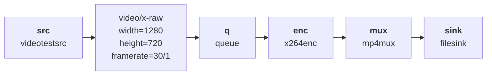
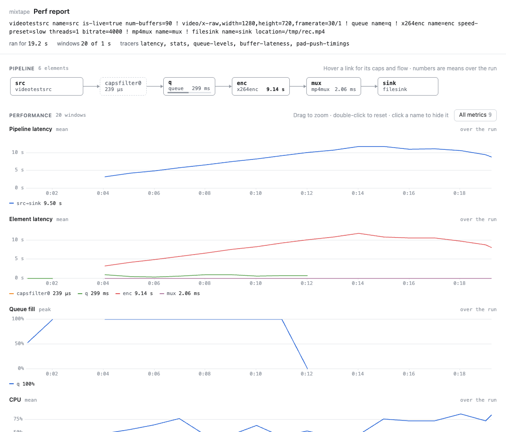
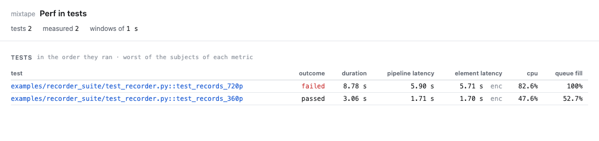

# Measuring performance

mixtape's `perf` feature measures a pipeline with GStreamer's own tracers: how long each
element holds a buffer, how long a buffer takes from the source to the sink, how full the queues
are, and how much CPU the process and each streaming thread use. It does that without a line of
your own code, for a pipeline on the command line, in a `Player`, or in a pytest suite.

This page follows one real problem: a live 720p recorder that encodes with x264 to an MP4 and
falls behind. We record it, read what `perf` wrote, find the cause, fix it, prove the fix, and
then keep it fixed with budgets in a test suite.

The recorder needs `x264enc`, from `gst-plugins-ugly` (Homebrew's `gstreamer` has it; on Ubuntu
install `gstreamer1.0-plugins-ugly`; without it, `no element "x264enc"`: see
[Troubleshooting](troubleshooting.md#no-element-x264enc)). `perf` also reads three tracers of `gst-plugins-rs`:
`queue-levels`, `buffer-lateness` and `pad-push-timings`. Without them their metrics (the
queues' fill, lateness and push time) are left out, with a warning.

## Record it

The recorder takes a live 720p source at 30 frames per second, queues it, encodes it with
x264 and writes an MP4. `num-buffers=90` ends it after three seconds. Two choices come from the
measuring: the elements have short names, because the report and the thread names use them
(Linux cuts a thread name to 15 bytes, so `q:src` fits and `videoconvert0:src` does not); and
the encoder is limited to one thread, as it would be on a machine that shares its cores with
other work. The preset is `slow`, for a good picture at a low bitrate.



`--feature perf,out=DIR` measures the run and writes everything to a folder. `out` is the only
option you need; `interval` sets the length of a window in seconds (default 1).

`summary.json` has the statistics of the whole run: for each metric, each subject (an element,
a pad, a thread) with the number of samples, the mean, p50, p95, p99 and max. This program
prints the worst subject of the main metrics by their p95:

```python
--8<-- "examples/perf_worst.py:worst"
```

Record, and read it:

```console
$ mixtape run "videotestsrc name=src is-live=true num-buffers=90 \
    ! video/x-raw,width=1280,height=720,framerate=30/1 ! queue name=q \
    ! x264enc name=enc speed-preset=slow threads=1 bitrate=4000 \
    ! mp4mux name=mux ! filesink name=sink location=/tmp/rec.mp4" \
    --feature perf,out=/tmp/perf-slow
$ python3 examples/perf_worst.py /tmp/perf-slow
metric            subject        p95     max
element.latency   enc           3.7s    3.9s
pipeline.latency  src→sink      3.9s    4.1s
queue.fill        q             100%    100%
process.cpu       process       103%    104%
thread.cpu        q:src          94%     95%
```

Your numbers will differ: they depend on the machine and on what else it is doing. What to read
is the shape, as the next sections do.

The folder has more than the summary:

- `report.html`: all of it on one page that works offline, below.
- `windows.jsonl`: one line per window, the statistics of that second, as the live page gets
  them.
- `samples.jsonl` and a `<metric>.csv` for each metric: every sample, as `t_ns,subject,value`
  (times are nanoseconds since GStreamer initialised).

`summary.json` also has `lost`: how many times the debug log dropped lines before `perf` read
them. When it is not 0, some tracer records are missing from the numbers, and `mixtape run` logs
a warning with the count at the end. It has a `format_version` too, 1: a reader takes a document
without one as 1, and it changes only when a field is renamed or removed.

`perf` reads GStreamer's debug log itself and passes on the lines that are not its tracers':
to stderr, or to the file `GST_DEBUG_FILE` names (`%p` is the process id, `-` is stdout), so
that file has your categories but not the tracer records. A `GST_DEBUG_FILE` with `%r`, a
number `perf` cannot know, gets the tracer records as well.

## The report



Open `report.html` in a browser. From the top:

- **The pipeline**: the elements as a graph. Each shows its mean latency, and a queue a bar
  with its fill. Hover over a link for its caps and flow.
- **The charts**: pipeline latency, the latency of each element, the fill of each queue and
  the CPU, window by window over the run. Drag to zoom, double-click to reset, click a name in
  the legend to hide it.
- **The whole run**: the table of `summary.json`, every metric with the n, mean, p50, p95, p99
  and max of each of its subjects.

## The numbers

The metrics have fixed names and units; [the list is in `mixtape/perf/metrics.py`](https://github.com/ashwoods/mixtape/blob/main/mixtape/perf/metrics.py).
The ones that matter here:

- `element.latency`: the time a buffer takes through an element, from its sink pad to its
  source pad. `pipeline.latency` is the same from the source to the sink, with the subject
  `src→sink`. Both come from the core `latency` tracer.
- `queue.fill`: how full a queue is, 0 to 1, and `queue.bytes`, `queue.buffers` and `queue.time`
  for what it holds. A queue that is full blocks what pushes into it.
- `process.cpu` and `thread.cpu`: CPU time over wall time, where 100 is one core. GStreamer names
  a streaming thread after its pad: the thread of a queue's source pad is `q:src`, and it runs
  everything downstream of the queue until the next queue, here the encoder, the muxer and the
  file. Threads that GStreamer does not name are `other`. `thread.cpu` leaves out perf's own
  threads (their names start with `mixtape-perf`: the log reader and the window writer), and
  `process.cpu` subtracts what they used, so both are the pipeline's and the app's. A thread
  that was busy once (over 0.1% of a core) and then went idle counts as 0 in the statistics of
  the run for its idle windows, though the chart does not draw it for them; a thread that
  was never busy is left out.
- `pad.buffers`, `pad.bitrate`, `pad.interval` (core `stats`), `pad.lateness` and `pad.push`:
  what each pad pushes, how fast, and how late.

## Find the problem

Read the table with the recorder's job in mind: take a frame every 33 ms and write it
out.

- `element.latency` of `enc` is seconds. The buffers wait in the encoder far longer than a
  frame lasts, and `pipeline.latency` is the same seconds: nearly all of the time from the
  source to the file is the encoder's.
- `queue.fill` of `q` reaches 100%. The queue holds about ten megabytes, a few frames of 720p, and
  it was full: the encoder was not taking frames as fast as the source made them.
- `thread.cpu` is highest on `q:src`, the thread that runs the encoder. It is busy,
  not waiting for anything.

A live source cannot slow down to wait. While the queue is full the source is blocked, and
a real camera would drop frames. The cause is the encoder's settings: `speed-preset=slow` spends
effort on every frame, and looks ahead of the frame it encodes, so a frame leaves the encoder
tens of frames after it entered. A recorder wants the opposite.

## Fix it, and prove it

`speed-preset=ultrafast` spends the least effort, and `tune=zerolatency` turns off the lookahead
and the B-frames. The price is a bigger file at the same picture quality. The second command
below changes only that. `mixtape perf compare BASE NEW` compares two runs and lists what
improved and what got slower beyond a threshold; it exits 0 when nothing got slower and 1 when
something did. The first command is the recording from above, so that this block runs on its own:

```console
$ mixtape run "videotestsrc name=src is-live=true num-buffers=90 \
    ! video/x-raw,width=1280,height=720,framerate=30/1 ! queue name=q \
    ! x264enc name=enc speed-preset=slow threads=1 bitrate=4000 \
    ! mp4mux name=mux ! filesink name=sink location=/tmp/rec.mp4" \
    --feature perf,out=/tmp/perf-slow
$ mixtape run "videotestsrc name=src is-live=true num-buffers=90 \
    ! video/x-raw,width=1280,height=720,framerate=30/1 ! queue name=q \
    ! x264enc name=enc speed-preset=ultrafast tune=zerolatency threads=1 bitrate=4000 \
    ! mp4mux name=mux ! filesink name=sink location=/tmp/rec.mp4" \
    --feature perf,out=/tmp/perf-fast
$ mixtape perf compare /tmp/perf-slow /tmp/perf-fast; echo "exit status $?"
Improvements:
  pipeline.latency  max  src→sink     4.06 s → 20.9 ms                -99%
  pipeline.latency  p95  src→sink     3.93 s → 17.2 ms                -99%
  element.latency   max  enc          3.87 s → 16.7 ms                -99%
  element.latency   p95  enc          3.73 s → 12.4 ms                -99%
  element.latency   max  q            353 ms → 13.3 ms                -96%
  element.latency   p95  q            282 ms → 8.36 ms                -97%
  queue.bytes       p95  q            11059200 bytes → 5529600 bytes  -50%
  queue.time        p95  q            66.7 ms → 33.3 ms               -50%
  element.latency   max  capsfilter0  2.48 ms → 262 µs                -89%
  element.latency   max  mux          2.61 ms → 1.17 ms               -55%
  thread.cpu        max  q:src        94.6% → 25.0%                   -74%
  thread.cpu        p95  q:src        94.4% → 24.8%                   -74%
  process.cpu       max  process      104% → 45.3%                    -57%
  process.cpu       p95  process      103% → 44.3%                    -57%
  queue.fill        p95  q            100% → 52.7%                    -47%

0 regressions, 15 improvements, 0 added, 0 removed (threshold 50%, 32 values compared)
exit status 0
```

The latency of the whole pipeline fell by two orders of magnitude, and the encoder is no longer
the busiest thing in the process. A value counts only when it changed by more than the threshold
(`--threshold`, default 50%) of the base *and* by more than a floor of its unit: 100 µs, 5 points
of CPU, 5% of a queue. It compares the p95 and the max of each latency, each CPU use and each
queue level, where a higher value is worse. It leaves out rates, lateness and push time, which
vary too much between two runs: bound those with a budget. The
[command line page](cli.md#compare-two-runs) has its options and its exit status.

A run whose debug log dropped lines (its `lost`, above) is marked, never failed: the text has a
"Lost log lines" section, and `--json` a `lost` list of `{"side": "base" or "new", "lost": N}`
(a session's items have the `"test"` too). The exit status stays 0, 1 or 2. A document with a
newer `format_version`, or without the fields compare reads, is a usage error: exit status 2.

!!! note "On a busy machine"
    The maxima of a latency are single frames, and a machine busy with other work delays
    some of them. There the compare above can list the latency of `mux` or `capsfilter0` as
    regressions, and exit 1. Compare runs made on a quiet machine, or run each side a few
    times. The CPU use is steadier: a window shorter than half the interval, such as the
    one a run ends with, has no CPU use or rates, since a few milliseconds of CPU would look
    large in it.

## Other sources

The same recorder on a camera, with the live source swapped. They are not run here, as they need
a camera or a server:

=== "macOS"

    ```console
    $ mixtape run "avfvideosrc device-index=0 \
        ! video/x-raw,width=1280,height=720,framerate=30/1 ! videoconvert name=conv \
        ! queue name=q ! x264enc name=enc speed-preset=ultrafast tune=zerolatency \
        ! mp4mux name=mux ! filesink name=sink location=/tmp/cam.mp4" \
        --feature perf,out=/tmp/perf-cam
    ```

=== "Ubuntu"

    ```console
    $ mixtape run "v4l2src device=/dev/video0 \
        ! video/x-raw,width=1280,height=720,framerate=30/1 ! videoconvert name=conv \
        ! queue name=q ! x264enc name=enc speed-preset=ultrafast tune=zerolatency \
        ! mp4mux name=mux ! filesink name=sink location=/tmp/cam.mp4" \
        --feature perf,out=/tmp/perf-cam
    ```

=== "RTSP"

    ```console
    $ mixtape run "rtspsrc location=rtsp://192.0.2.10/stream latency=200 \
        ! rtph264depay ! h264parse ! avdec_h264 ! videoconvert name=conv \
        ! queue name=q ! x264enc name=enc speed-preset=ultrafast tune=zerolatency \
        ! mp4mux name=mux ! filesink name=sink location=/tmp/cam.mp4" \
        --feature perf,out=/tmp/perf-cam
    ```

A camera does not end by itself: stop the run with Ctrl-C, which ends the stream, and the
folder is written. With a real source `pipeline.latency` includes the time of `rtspsrc`'s jitter
buffer, set by its `latency` property.

## Watch it live

With `--http` the same numbers are live on the control page: the graph shows each element's
latency and each queue's fill as the pipeline runs, and charts show the last five minutes of
every metric. `perf` publishes the latest window as the property `perf.summary`, which the
[HTTP API](http.md) serves like any other. A live source has no `num-buffers`, and with
`--http` the player keeps running after the end of a stream, until it is interrupted:

```console
$ mixtape run "videotestsrc name=src is-live=true \
    ! video/x-raw,width=1280,height=720,framerate=30/1 ! queue name=q \
    ! x264enc name=enc speed-preset=ultrafast tune=zerolatency threads=1 bitrate=4000 \
    ! mp4mux name=mux ! filesink name=sink location=/tmp/rec.mp4" \
    --feature perf --http 8047
Serving on http://127.0.0.1:8047
```

## First in the process

GStreamer's tracers exist only if GStreamer creates them when it initialises, once per process.
`mixtape run` and `Player.from_description` prepare the features before anything initialises
GStreamer, so a `perf` they build works. A program that initialised GStreamer first, or imported
something that did, cannot have it, and the error says so
([Troubleshooting](troubleshooting.md#gst-tracers) has the fix):

```python
--8<-- "examples/perf_late.py:late"
```

```console
$ python3 examples/perf_late.py
The feature 'perf' needs the tracers 'latency', 'stats', but GStreamer could not create them (its warnings say why) or was initialised before it could set GST_TRACERS: build the player with Player.from_description(..., features=['perf']) or run `mixtape run --feature perf` before anything else initialises GStreamer, or set GST_TRACERS yourself
```

The rule is the same for the `tracers` feature and for `gst:NAME`. The tracers are one per
process, not one per player, so one player at a time can measure: two players with `perf` in one
process each record both pipelines ([Two pipelines](two-pipelines.md#what-mixtape-does-across-two-players)
has an example). Run them in two processes to measure them apart.

## The cost on a fast pipeline

On a pipeline that pushes as fast as it can, `perf` adds a lot of CPU, most of it system time.
This is a known cost of the tracers, not of your setup. The three `gst-plugins-rs` tracers
that `perf` reads (`queue-levels`, `buffer-lateness` and `pad-push-timings`) write their log
with one unbuffered write per record, so their cost grows with the number of buffers. On
`audiotestsrc num-buffers=20000 ! queue ! audioconvert ! identity ! queue ! fakesink sync=false`,
about 320,000 records, they took about 9 s of CPU; the run took 0.3 s without tracers.
`mixtape run` with `perf` costs about as much as `gst-launch-1.0` with the same tracers, so the
cost is the tracers', not mixtape's. It is in `gst-plugins-rs` 0.15.4, which Homebrew installs and
`scripts/build-rs-plugins` builds, measured on macOS with GStreamer 1.28.9. mixtape does not work
around it yet.

The records also fill the debug log. On such a pipeline the log of a busy thread can outgrow the
4 MiB that `perf` reads from, and `lost` in `summary.json` is then not 0 (see
[Record it](#record-it)): `pad.interval` and the other metrics of the core tracers are missing
records. That run lost about half of its `pad.interval` records. A live pipeline, or one with
`sync=true`, makes records at its real rate, far fewer per second, so neither problem is likely
there.

## The recorder as a test suite

Installing mixtape adds a pytest plugin that measures every test of any GStreamer suite with
the same tracers, whether it uses a `Player` or calls `Gst.parse_launch` itself, as this one
does. The suite records two seconds of the same recorder, at 720p and at 360p. `RECORDER_ENCODER`
sets the encoder's options, so that we can break it later:

```python
--8<-- "examples/recorder_suite/test_recorder.py:recorder"
```

A budget is the marker `@pytest.mark.perf`. It fails the test at the end of its call when the worst
subject of a metric is over its limit. The 720p test must keep its latency under half a second
and use no more than a core and a half; the 360p test is measured, with no budget:

```python
--8<-- "examples/recorder_suite/test_recorder.py:budgets"
```

The keyword is a metric (`.` written as `_`) and a statistic (`n`, `mean`, `p50`, `p95`, `p99`
or `max`, as in `summary.json`). The limit is a string with a unit (`ns`, `us` or `µs`, `ms`, `s`
for the metrics in nanoseconds; `%` for CPU, and for a ratio such as `queue.fill`, where `90%` is
0.9) or a number in the metric's own unit. An unknown metric, statistic or unit is a usage error
before any test runs.

Run it with `--mixtape-perf DIR`. `--junitxml` is the usual option, and the plugin puts the
numbers in it too: `perf.<metric>.p95` and `perf.<metric>.max` for each test (times in
nanoseconds), and the budgets as `perf.budget.<metric>.<stat>`. The second command picks out
the properties of the pipeline latency, with the name of each test before its properties:

```console
$ pytest -q examples/recorder_suite --mixtape-perf /tmp/perf-out --junitxml=/tmp/junit.xml
$ grep -oE '(name="test_[a-z0-9_]+"|name="perf\.(budget|pipeline\.latency)[a-z.0-9]*" value="[^"]*")' \
    /tmp/junit.xml
..                                                                       [100%]
mixtape perf: 2 of 2 tests measured, index at /tmp/perf-out/index.html
2 passed in 4.16s
name="test_records_720p"
name="perf.budget.pipeline.latency.p95" value="500000000.0"
name="perf.budget.process.cpu.mean" value="150.0"
name="perf.pipeline.latency.p95" value="30591647.9"
name="perf.pipeline.latency.max" value="32136541.0"
name="test_records_360p"
name="perf.pipeline.latency.p95" value="12758020.55"
name="perf.pipeline.latency.max" value="14901000.0"
```

Each test that ran a pipeline gets a folder in `/tmp/perf-out/` with its `windows.jsonl`,
`summary.json` and `report.html`, as `mixtape run` wrote them (its window is from the start of
its setup to the end of its teardown; `--mixtape-perf-samples` adds the samples and the CSVs, and
`--mixtape-perf-interval SECONDS` sets the window). `index.json` has every test's outcome,
duration, `lost` and the worst p95, max and mean of each metric with the subject that had it, a
`format_version` as `summary.json` does, and
`index.html` is the same as a page that links to the reports. Without the option the plugin does
nothing.

### A budget fails

Break the recorder: `RECORDER_ENCODER` puts the slow preset back.

```console
$ RECORDER_ENCODER="speed-preset=slow" pytest -q examples/recorder_suite \
    --mixtape-perf /tmp/perf-slow-out
F.                                                                       [100%]
=================================== FAILURES ===================================
______________________________ test_records_720p _______________________________
perf budget: pipeline.latency p95 is 5.90 s on src→sink, over 500 ms
mixtape perf: 2 of 2 tests measured, index at /tmp/perf-slow-out/index.html
=========================== short test summary info ============================
FAILED examples/recorder_suite/test_recorder.py::test_records_720p - Failed: ...
1 failed, 1 passed in 11.86s
```

The message names the metric and the statistic, the subject that had the worst value, the value
and the limit. A metric the test has no samples of fails too, and when the log of the test lost
lines, the failure adds a line saying that the numbers are incomplete. The 360p test passed, as
it has no budget, but `index.html` shows what happened to it:



### A baseline

A budget bounds what you chose to bound. The other check compares the whole session with an
earlier one: `--mixtape-perf-baseline BASE` takes the `--mixtape-perf` folder of that session
(CI keeps the one of the main branch), compares at the end as `mixtape perf compare` does,
writes `compare.json` next to the index (the same JSON as `mixtape perf compare --json`; from
0.8, fields are only added, never renamed or removed: `lost` is an addition), prints the result
in its own section and fails the session, exit status 1, on a regression. Here the baseline is
a session with the fast encoder, and the new one runs only the 360p test with the slow one:

```console
$ pytest -q examples/recorder_suite --mixtape-perf /tmp/perf-base > /dev/null
$ RECORDER_ENCODER="speed-preset=slow" pytest -q examples/recorder_suite -k 360p \
    --mixtape-perf /tmp/perf-new --mixtape-perf-baseline /tmp/perf-base; echo "exit status $?"
.                                                                        [100%]
mixtape perf: 1 of 1 tests measured, index at /tmp/perf-new/index.html
============================= mixtape perf compare =============================
/tmp/perf-base → /tmp/perf-new
Regressions:
  examples/recorder_suite/test_recorder.py::test_records_360p  element.latency   max  enc       7.78 ms → 1.86 s               +23820%
  examples/recorder_suite/test_recorder.py::test_records_360p  pipeline.latency  max  src→sink  11.5 ms → 1.86 s               +16127%
  examples/recorder_suite/test_recorder.py::test_records_360p  element.latency   p95  enc       7.25 ms → 1.85 s               +25370%
  examples/recorder_suite/test_recorder.py::test_records_360p  pipeline.latency  p95  src→sink  10.1 ms → 1.85 s               +18115%
  examples/recorder_suite/test_recorder.py::test_records_360p  queue.bytes       max  q         2764800 bytes → 6912000 bytes  +150%
  examples/recorder_suite/test_recorder.py::test_records_360p  queue.time        max  q         66.7 ms → 167 ms               +150%
  examples/recorder_suite/test_recorder.py::test_records_360p  queue.bytes       p95  q         2764800 bytes → 5529600 bytes  +100%
  examples/recorder_suite/test_recorder.py::test_records_360p  queue.time        p95  q         66.7 ms → 133 ms               +100%
  examples/recorder_suite/test_recorder.py::test_records_360p  process.cpu       max  process   23.5% → 115%                   +391%
  examples/recorder_suite/test_recorder.py::test_records_360p  process.cpu       p95  process   23.4% → 109%                   +365%
  examples/recorder_suite/test_recorder.py::test_records_360p  thread.cpu        max  q:src     14.2% → 71.9%                  +406%
  examples/recorder_suite/test_recorder.py::test_records_360p  thread.cpu        p95  q:src     14.2% → 70.8%                  +399%
  examples/recorder_suite/test_recorder.py::test_records_360p  queue.fill        max  q         26.4% → 65.9%                  +150%
  examples/recorder_suite/test_recorder.py::test_records_360p  queue.fill        p95  q         26.4% → 52.7%                  +100%
  examples/recorder_suite/test_recorder.py::test_records_360p  queue.buffers     max  q         2 buffers → 5 buffers          +150%
  examples/recorder_suite/test_recorder.py::test_records_360p  queue.buffers     p95  q         2 buffers → 4 buffers          +100%

Removed:
  examples/recorder_suite/test_recorder.py::test_records_720p

16 regressions, 0 improvements, 0 added, 1 removed (threshold 50%, 16 values compared)
1 passed, 1 deselected in 3.27s
exit status 1
```

The test passed, and the session still failed: the baseline caught what had no budget. A test
the new session does not have is listed as removed, never as a regression. Tests are matched by
their id, so keep the baseline from the same suite.

The plugin needs the tracers like `perf` does, so it initialises GStreamer before pytest reads
the first `conftest.py`, and stops with a usage error when something did so earlier: a plugin
loaded with `-p` or `PYTEST_PLUGINS` that imports `gi` and initialises it first. It gives
`GST_TRACERS` back to the environment, so the processes your tests start measure nothing. A
session is measured serially, so `--mixtape-perf` with `pytest-xdist` workers (`-n` above 0) is
a usage error: run without `-n`, or with `-n 0`. Parallel workers share the cores, so their
numbers would not compare with a serial baseline, and each would write its own index.
