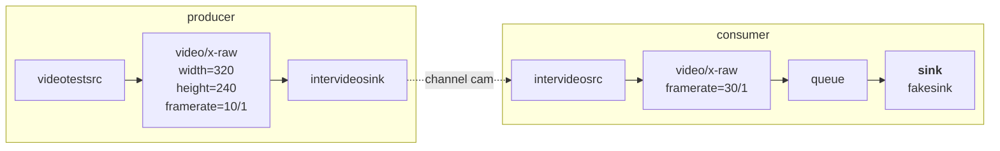
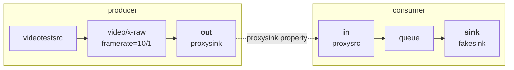
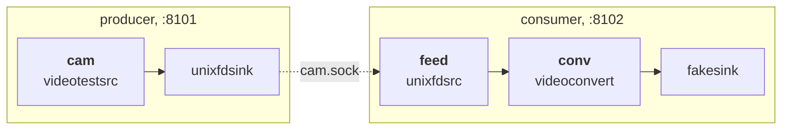
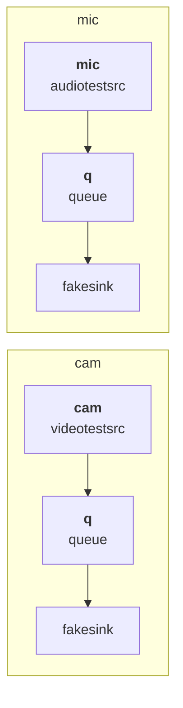

# Two pipelines

A `Player` drives one pipeline. When one pipeline has to feed another, mixtape has nothing of
its own for it: you build two players and link them with GStreamer elements, in one process or
across two. This page lists the elements that can do it, says which to pick, runs one example
of each kind, and ends with what mixtape does for two players, and what it does not.

## The ways to connect two pipelines

| Elements | Where | What passes | Notes |
|----------|-------|-------------|-------|
| `intervideosink` / `intervideosrc`, `interaudiosink` / `interaudiosrc` (gst-plugins-bad) | same process | raw video or raw audio only | linked by `channel` name; the receiver keeps its own rate and repeats frames |
| `proxysink` / `proxysrc` (gst-plugins-bad) | same process | any caps; events and queries pass too | linked by object in code: `proxysrc`'s `proxysink` property; both pipelines need one clock and one base time |
| `intersink` / `intersrc` (gst-plugins-rs) | same process | any caps | linked by `producer-name`; Homebrew installs it, Ubuntu does not package it |
| `appsink` / `appsrc` | same process | anything you pass along | your Python runs on the streaming thread |
| `shmsink` / `shmsrc` (gst-plugins-bad) | two processes | raw bytes | the receiver is told the caps; no zero copy |
| `unixfdsink` / `unixfdsrc` (gst-plugins-bad) | two processes | any caps, which travel with the buffers | zero copy; GStreamer 1.24 and later |
| UDP and RTP, WebRTC | two machines | encoded media | see [A WebRTC client](webrtc.md) |

RidgeRun's `interpipe` links pipelines by name too, but neither Homebrew nor Ubuntu packages it.

## Which one to use

- A lossless link between two players of one process, which share a clock: **`proxysink` and
  `proxysrc`**. Every buffer arrives, and so do the EOS and the queries.
- Two players that must not depend on each other, one of which comes and goes: **`intervideo` or
  `interaudio`**. The consumer keeps its own rate, and carries on when the producer stops.
- Two processes: **`unixfdsink` and `unixfdsrc`**.

The other elements are for what these do not cover: `intersink` for any caps, linked by name,
where gst-plugins-rs is installed; `appsink` and `appsrc` when your code has to touch the data;
`shmsink` between processes below GStreamer 1.24.

## Decoupled: intervideo

The producer plays a camera at 10 frames per second into the channel `cam`. The consumer reads
the channel at 30:



```python
--8<-- "examples/inter_restart.py:players"
```

Both players run in one asyncio loop. The consumer is started first, then the producer is
stopped, and played again, while the program counts the frames the consumer's sink renders in a
second:

```python
--8<-- "examples/inter_restart.py:count"
```

```python
--8<-- "examples/inter_restart.py:main"
```

The consumer did not stop with the producer: `intervideosrc` makes a frame at the consumer's
rate, and repeats the last one it got when no new one has come. When the producer stops it
makes black frames, straight away, and so it does when the producer is paused for longer than
its `timeout` property (one second). The two pipelines have their own state: stopping one does
not touch the other.

## Lossless: proxysink and proxysrc

`proxysrc` takes buffers, events and queries from a `proxysink`, and it is linked to it in code.
The two pipelines then have to agree on time: they use one clock, and one base time, the clock
time that is their running time 0. A buffer is stamped with the running time of the pipeline that
made it, and a consumer with another base time sees it earlier or later than it was meant:



```python
--8<-- "examples/proxy_link.py:link"
```

Both pipelines pick the system clock unless one of their elements provides another one, so
`use_clock` only makes sure. `set_start_time` with `CLOCK_TIME_NONE` is not optional: without
it a pipeline sets its base time again when it goes to PLAYING, and the one you set is gone.

The order the pipelines start in matters. `proxysrc` has nothing to show until the producer
pushes a buffer, so the consumer's `play()` does not return before the producer plays: start
the producer first, or start both at once.

```python
--8<-- "examples/proxy_link.py:order"
```

A producer that ends sends its EOS through the link, and the buffers before it are all there.
This producer is not live, so it waits for the consumer; a live one does not, and a buffer it
pushes before the consumer is playing can be lost (the first one went missing in 4 of 30
runs on one machine):

```python
--8<-- "examples/proxy_link.py:eos"
```

And the base time is what keeps the two on one timeline. Here the producer plays for 1.5
seconds before the consumer starts. With a shared base time the consumer's first frame comes in
well under that; with a base time of its own, its sink, which waits for the clock, holds the
frame back until the consumer has been running as long as the producer had:

```python
--8<-- "examples/proxy_link.py:lag"
```

```python
--8<-- "examples/proxy_link.py:main"
```

## Two processes: unixfd

`unixfdsink` listens on a socket, and passes the buffers to the `unixfdsrc` that connects to
it, as file descriptors: the frames are not copied. The caps travel with them, so the consumer's
description has none. The producer has to be listening before the consumer starts, as
`unixfdsrc` fails to start without a socket to connect to.

Each process is a `mixtape run --http`, with its own control page and its own `perf`. Run the
two commands in two terminals; the block below runs both in one shell, asks each process for
the pads its `perf` measured, and stops them:



```console
$ dir=$(mktemp -d)
$ mixtape run --http 8101 --feature perf \
    "videotestsrc is-live=true name=cam ! unixfdsink socket-path=$dir/cam.sock" &
$ producer=$!
$ until [ -S $dir/cam.sock ]; do sleep 0.1; done
$ mixtape run --http 8102 --feature perf \
    "unixfdsrc name=feed socket-path=$dir/cam.sock ! videoconvert name=conv ! fakesink" &
$ consumer=$!
$ sleep 3
$ echo "producer, :8101:"; curl -s localhost:8101/api/properties | grep -o '"[a-z]*:src"' | sort -u
$ echo "consumer, :8102:"; curl -s localhost:8102/api/properties | grep -o '"[a-z]*:src"' | sort -u
$ kill $producer $consumer
$ wait
$ rm -r $dir
Serving on http://127.0.0.1:8101
Serving on http://127.0.0.1:8102
producer, :8101:
"cam:src"
consumer, :8102:
"conv:src"
"feed:src"
Interrupt: stopping (EOS)…
Interrupt: stopping (EOS)…
```

Open the two addresses and each page has the graph and the charts of its own pipeline. Each
process measures only what runs in it.

## What mixtape does across two players

Each `Player` is a complete one, with its own bus watch, its own model of the pipeline (its
properties, commands and graph) and its own events. Nothing in one sees the other. You can
serve each on a port of its own: `serve` takes the player and the address, and with port 0 it
picks one.

The tracers are another matter. GStreamer creates them once per process, when it initialises,
and mixtape's `perf`, `leaks` and `tracers` features read them: they are **one per process**,
not one per player. For `perf` that is the collector in `mixtape/perf/collect.py`, one per
process, and every recorder (`mixtape/perf/record.py`) gets every sample the process makes.
So with `perf` on two players in one process:

- each player records both pipelines, and shows both on its page;
- elements of the same name in the two pipelines share one subject: two queues named `q` are
  one `q`.



```python
--8<-- "examples/two_players.py:serve"
```

```python
--8<-- "examples/two_players.py:perf"
```

```python
--8<-- "examples/two_players.py:main"
```

Each page lists its own pipeline's elements, and each player's `perf` has counted buffers of the
pads of both: `cam:src` and `mic:src`. The `leaks` feature documents the same limit: one
player at a time can track.

To measure two pipelines apart, run them in two processes, as in the unixfd example above: each
has its own tracers, its own `perf` and its own control page. Names are free to repeat there.

A way to group the players of a process or of several, one control page and one `perf` for
the session as a whole, is a feature mixtape may get one day (a "Session"). Nothing of it
exists today.
