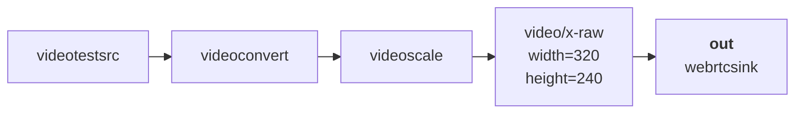
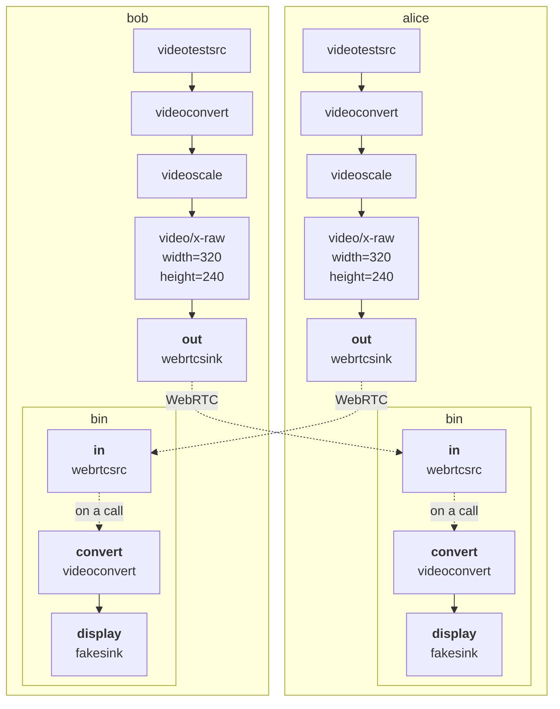

# A WebRTC client

`examples/webrtc_client.py` is an application that makes calls. It publishes a video source
and plays the video of another client, so two of them make a call, each seeing the other. It
is built on `webrtcsink` and `webrtcsrc` from gst-plugins-rs and their built-in signalling: the
clients find each other through a signalling server, then send their video peer to peer.

Each client is a `Player`, so it gets what any player gets: `mixtape run` with a control page,
and live metrics. The call is a command, and who publishes, who is being played and how many
frames arrived are properties.

## Install

`webrtcsink` and `webrtcsrc` are not part of GStreamer itself, they are in gst-plugins-rs.
`webrtcbin`, which they use, needs libnice for ICE:

=== "macOS"

    ```console
    $ brew install gstreamer libnice-gstreamer
    ```

    Homebrew's `gstreamer` includes the Rust plugins.

=== "Ubuntu"

    ```console
    $ sudo apt install gstreamer1.0-plugins-bad gstreamer1.0-nice \
        libgstreamer-plugins-base1.0-dev libgstreamer-plugins-bad1.0-dev
    ```

    Ubuntu does not package the Rust plugins. `scripts/build-rs-plugins` builds them from
    gst-plugins-rs 0.15.4 with cargo (Rust 1.92 or newer), the same way CI does, and
    `GST_PLUGIN_PATH` lets GStreamer find them:

    ```console
    $ scripts/build-rs-plugins ~/.cache/gst-rs-plugins
    $ export GST_PLUGIN_PATH=~/.cache/gst-rs-plugins
    ```

Check that both elements are there:

```console
$ gst-inspect-1.0 --exists webrtcsink && gst-inspect-1.0 --exists webrtcsrc && echo found
found
```

## A call on one machine

Run the signalling server and one client in a terminal. `--serve` makes the client run the
server too, which `webrtcsink` can do itself:

```console
$ python3 examples/webrtc_client.py --serve --name host
```

It publishes a test pattern, and waits. In another terminal, start a second client, which calls
the first by its name as soon as it publishes, and exits when it has seen 60 frames of its
video:

```console
$ python3 examples/webrtc_client.py --name guest --call host
```

To try it without a second terminal, `--demo` runs two clients in one process, alice with
the server and bob, which call each other:

```console
$ python3 examples/webrtc_client.py --demo
alice received 60 frames from bob
bob received 60 frames from alice
```

The test pattern is only the default. `--camera` publishes the camera instead, and
`--sink autovideosink` shows the remote video in a window instead of dropping it:

```console
$ python3 examples/webrtc_client.py --camera --sink autovideosink --call
```

Without an argument `--call` calls the first client that publishes. On a network, every
client gets the server's address with `--server ws://host:8443`, and the two
`stun-server=NULL` in the code below must go, so that ICE can ask a STUN server for the
address to use.

## How it works

### What a client publishes

`publisher` makes the pipeline description: a source, scaled down to keep the encoding cheap,
into a `webrtcsink`. The sink offers the video to whoever calls it, and
encodes it once for each caller. The `meta` property is how a client says its name to the
others. `stun-server=NULL` is for a call on one machine: no STUN server is asked for the
address, so nothing goes out on the network. `congestion-control=disabled` leaves out the
bandwidth estimation, which needs a plugin of its own.



```python
--8<-- "examples/webrtc_client.py:publish"
```

With `serve` the sink also runs the signalling server, in the same process. Every client
connects to a server over a WebSocket, the one its `signaller::uri` names. gst-plugins-rs also
has `gst-webrtc-signalling-server`, a program that does only that, which any of the clients can
use instead.

### The client

A `Client` is a `Player` with that pipeline. `webrtcsrc` plays a given peer, but cannot list
who publishes, so the client asks the signalling server itself: it creates a second
signaller of the sink's kind, as a listener, and the server tells it who joins and who leaves.
GStreamer's signals come on threads of their own, so they are handed to the asyncio loop
before they touch the properties. The listener is stopped on a thread of its own, and the
client waits for it at most two seconds: in gst-plugins-rs 0.15 the signaller's `stop` can
deadlock when a peer's status arrives just as it stops, and it would take the loop with it.

```python
--8<-- "examples/webrtc_client.py:client"
```

### The properties

What the client knows is read-only properties. A control page shows them, and the client says
when one changes with `notify`.

```python
--8<-- "examples/webrtc_client.py:props"
```

### The call

`call` finds the peer in the list, by id or name, and plays it: it adds a `webrtcsrc`, a
converter and the sink to the running pipeline as a bin. Frames are counted with a probe on
the converter's sink pad. The probe and the signaller's `webrtcbin-ready` run on GStreamer's
threads, so they too go to the loop, with the bin they belong to: a frame or a late signal
of a call that has been hung up is ignored. `hangup` removes the bin again, and a client can call someone else
afterwards. Both are commands, so the control page has them as buttons, and a failed call is a
`CommandError`: the page shows its message.



```python
--8<-- "examples/webrtc_client.py:call"
```

### The host

A `Host` is a client that also runs the signalling server. It exists so that
`mixtape run examples.webrtc_client:Host` starts one, and it keeps the server quiet: the
plugin logs a line for every peer that joins.

```python
--8<-- "examples/webrtc_client.py:host"
```

### The program

`main` wires the options to these: `--serve` picks `Host`, `--call` a call that ends the
program, and `--demo` runs both sides in one process. A call has 30 seconds to get going.

```python
--8<-- "examples/webrtc_client.py:main"
```

## The control page

Because a client is a `Player`, `mixtape run` starts it with a control page. A host and a client,
each with its page, make a call you can drive from the browser: open the client's page, and
`call` the host from its commands.

```console
$ mixtape run examples.webrtc_client:Host --http 8000 &
$ mixtape run examples.webrtc_client:Client --http 8001
Serving on http://127.0.0.1:8000
Serving on http://127.0.0.1:8001
```

The page lists the properties of the last section, and the elements of the pipeline: `out`,
the sink with its signaller, and during a call `in`, the source with its webrtcbin, and the
converter and sink after it. `connection` goes from `new` to `connected`, and `frames` counts
up.

## Performance

`--feature perf` measures a pipeline with GStreamer's tracers. The sending side exists from
the start, and is measured as any pipeline is:

```console
$ mixtape run examples.webrtc_client:Host --http 8000 --feature perf
Serving on http://127.0.0.1:8000
```

The receiving side is different: `call` adds its elements after perf has started, so perf has no
record of their creation, and says so in a warning for each. What it measures of them is
incomplete. See [Measuring performance](perf.md) for what the page shows.
